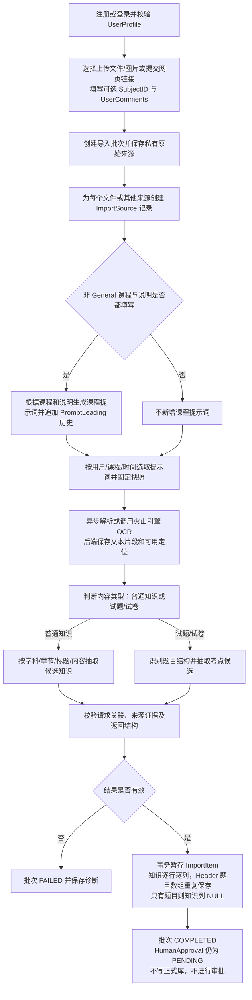

# 4.1 知识导入与整合流程模块设计

> 本文是“AI学习助手APP”中 4.1「知识导入与整合流程」的开发基线，仅定义本模块，不包含代码实现。后续开发应以本文的流程、状态、数据约束和验收标准为准；未决项在文末列出。

> 2026-11-08 首期范围修订（待开发）：以[结果返回落表设计](结果返回落表设计-20261107-WIP.md)为落表基线。首期只校验并暂存 `ImportItem`，不进行整合、人工审批或写入 `KnowledgeBase` / `QuestionBank`。下文尚保留的审核界面、知识分类和正式提交规则均为后续阶段参考，不是首期验收门槛；输入来源、身份安全、OCR 和提示词快照规则继续有效。

## 1. 目标与范围

### 1.1 目标

用户注册并登录后提交文档、图片或网页，系统将原文件保存到私有存储，并建立导入批次及逐来源记录。系统异步解析或调用火山引擎 OCR，抽取知识及题目，校验后仅保存到 `ImportItem`。候选匹配、整合、人工审批及正式知识/题库写入延期，不属于首期。

### 1.2 本次设计范围

- 文件/图片上传和网页链接导入；识别为试卷或试题时，进入试题识别分支。
- 基于 `UserProfile` 的用户名/密码注册、登录和退出；注册信息只包含用户名、密码。
- 私有文件存储、内容提取/OCR、知识与题目抽取、返回结果校验及暂存。
- 导入状态、暂存预览、来源关联和空值/重复 Header 保存规则；差异审核和人工批准延期。
- 失败重试、重复提交、并发编辑及基本访问控制。

不在本模块首期实现完整试卷分析、题目作答/评分、知识训练、学习计划和知识库全量管理。试卷分支只暂存 Header 级题目数组与明细级知识，不写正式题库或计算考试热度；后续题库模块另行处理。

### 1.2.1 最新落表约定（待开发）

- 只有 `KnowledgeItems[]` 为明细级，每个知识点对应一行，各知识字段分别落列。
- `QuestionItems[]` 为 Header 级，整体序列化到新增 `ImportItem.QuestionItemsJson`；同份接受结果的多个知识行重复保存完整数组。一题对应多知识的关系保留在数组内，不逐题拆行，不新增 `RowType` / `HeaderItemID` 或单独 Header 行结构。
- 只有题目时仍保存承载记录，知识编号、标题、正文、知识证据等专用列为 SQL `NULL`，不是字符串 `"Null"`。单来源一条承载记录，多来源按真实来源保存必要记录，题目来源不丢失；主键、批次、来源及题目数组仍有效。两数组均为空则不创建空知识行。
- 仅知识行预分配全局原子递增十进制 `KnowledgeID`，已有编号不改变，允许跳号；预留编号不表示正式知识已创建。题目承载记录不分配编号。
- 所有暂存记录 `HumanApproval=PENDING`，成功或失败不改为人工批准/拒绝；批次处理状态保存在 `ImportBatch.Status`，暂存完成即 `COMPLETED`。
- 同份接受结果事务性保存所有知识行、数组副本和必要承载记录；读取题目按接受结果关联只消费一份 Header 数组，不能把副本拼接成重复题目。

### 1.3 依据

- 《AI学习助手APP开发设计文档》4.1、5.1、5.2、9.1 和 14.2。
- 《数据库MOCKUP.xlsx》中的 `KnowledgeBase`、`QuestionBank`、`PromptLeading` 表草案。
- `4.1 知识导入与整合流程.jpg` 的普通知识/试题分支，以及登录后知识与用户关联的要求。
- 项目构想中的学科、章节、标题、内容四级知识结构；英语知识可在内容中包含音标、释义和例句。

## 2. 角色、边界与基本规则

- **知识所有者：** 已登录用户。每个导入批次及其候选、知识、来源记录都必须绑定 `UserID`。
- **用户：** 注册、登录，提交来源、查看进度及暂存结果；审核和正式入库属于后续阶段。
- **系统：** 首期负责提取、响应校验和暂存；不得写入或覆盖正式知识/题库。
- **AI 服务：** 提供结构化抽取结果，不是事实源；未知值和无法识别的内容必须明确返回，不假装审批或正式入库成功。

数据按 `UserID` 隔离。MVP 不跨用户检索候选、合并知识或展示文件；用户只能确认、重试或取消自己的导入。

## 3. 端到端流程



### 3.1 关键流程约束

1. 上传成功后立即建立一个导入批次及其来源记录，返回批次 ID、来源 ID 列表与进度，不等待 OCR/模型同步完成。
2. 文件二进制保存到私有 Blob（本地开发时为私有文件目录），不直接写入 SQL；每个文件对应一条 `ImportSource`，保存容器名、对象 key、原始文件名、MIME、大小、SHA-256 和 `ImportBatchID`。`ImportBatchID` 在批次表中唯一，在来源表中可重复；`SourceID` 是每条来源记录独立的 UUID 主键。
3. `ImportSource` 记录来源已接收，不代表知识已经审核或入库；模型结果保存在关联的 `ImportItem` 中，不另建来源接收 Trace。
4. 每个候选都通过 `SourceID` 关联来源，并保存原文片段位置（如页码、段落、字符区间）；链接来源保留 URL、标题和提取时间。
5. **首期结果只写 `ImportItem`，不写正式知识库或题库。**`HumanApproval` 初始 `PENDING` 并保持不变，知识行 `Decision=NEW` 只是未整合初始值；只有题目时知识决策为空。审核及分类规则属于后续阶段。
6. 批次、来源记录和候选须按外键关系保存；模型返回和候选保存须校验当前用户拥有相应批次及来源记录。
7. 同份接受结果的 `ImportItem` 行、Header 数组副本、编号预留关联及批次完成状态须事务性保存；失败回滚，再记录批次错误。重试不得重复创建批次、来源、知识暂存或题目承载记录；首期没有正式知识提交事务。

## 4. 用户界面与交互

首期保留登录/注册、来源上传、导入记录、配置管理和暂存详情。下文涉及分类、人工审核下拉及批准后保存正式知识的控件仅作为后续阶段参考，首期不开放审批或正式提交操作；仅题目承载记录的知识列展示为无内容，不显示字符串 `Null`。

### 4.1 页面结构与视觉设计

本模块有三个主业务页签；登录/注册为无页签的独立页面。知识详情由导入记录页签打开为模态悬浮页面：

1. **新建知识导入**：Agent 对话框式输入体验，支持课程上下文、文字说明、附件/链接和提交。
2. **导入记录**：查看导入批次及其来源、候选审核状态，支持筛选、分页和进入详情。
3. **配置管理**：按课程、用户筛选并编辑 `PromptLeading`，可新增和批量保存。
4. **知识详情弹窗**：由导入记录中的“知识详情”操作打开，展示并编辑该批次的 AI 候选、来源和审核状态。

本地预览的配置管理可访问本地库的全部用户和共享记录；用户留空表示共享，创建时间为 UTC。配置变更不修改已保存的批次快照，生产接入前必须实现身份认证和相应授权。

#### 登录与注册页面

- 未登录访问受保护页面时先显示登录页；成功登录后返回知识导入主页面。
- 登录表单只包含用户名和密码；服务端按 `UserProfile.UserID` 查找账户，并使用密码哈希验证，不得明文比较或返回哈希。
- 登录页提供“注册”入口，跳转至独立注册页。注册只要求用户名和密码；成功后返回登录页，不要求邮箱、手机号或其他资料。
- 注册操作按钮去重（待开发）：保留“注册”按钮，不另设功能相同的“创建账户”按钮。登录页的“注册”仅用于进入注册页；注册页只保留一个“注册”提交按钮，可另保留“返回登录”导航，不重复提供注册入口。
- 用户名对应 `UserProfile.UserID`，去除首尾空格后验证，并在数据库唯一约束下创建；长度 1–100 字符。密码长度 12–128 字符，不强制字符类别组合；不得在日志或响应中记录密码。
- 注册时使用 Argon2id 生成带随机盐的密码哈希，写入 `UserProfile.PasswordHash`；登录时调用同一密码哈希库的验证函数。禁止明文存储、可逆加密、自制哈希或把密码放入浏览器持久存储。
- 登录成功建立服务端验证的会话；会话凭证使用 `HttpOnly`、`SameSite=Lax` Cookie，生产环境还须设置 `Secure`、CSRF 防护、会话过期/退出失效与登录限速。`UserID` 从会话确定，API 请求体不接受客户端指定的所有者。
- 用户名不存在与密码错误返回相同的通用错误信息；注册时重名清楚提示用户更换用户名。生产日志不记录密码、密码哈希或会话凭证。

```text
登录页                         注册页
用户名 [________________]      用户名 [________________]
密码   [________________]      密码   [________________]
[登录]   [注册]                 [注册]
```

#### 欢迎横幅

- 页面品牌显示“好玩儿科技”；顶部显示个性化欢迎语：`{当前登录用户 UserID}，开启快乐学习之旅！`，副标题为“聚沙成塔，一问一答，强化理解和记忆”。
- 采用欢快、明亮但不刺眼的视觉：浅暖白/奶油色内容背景，欢迎横幅使用晴空蓝至明黄的轻柔渐变，橙色、薄荷绿作为少量操作/状态点缀；卡片圆角、留白充分，避免大面积高饱和色。
- 中文字体使用系统无衬线字体栈，例如 `Microsoft YaHei`、`PingFang SC`、`Noto Sans SC`；欢迎主标题约 28–32 px，页签约 16–18 px，正文约 14–16 px，辅助信息约 12–14 px。文字颜色与背景需保持清晰对比。
- 桌面端横幅位于页面 header 下方、页签上方；窄屏下允许横幅高度和主标题字号收缩，不遮挡主要操作。

#### 主页面线框

```text
┌──────────────────────────────────────────────────────────────────────┐
│ 好玩儿科技                                      帮助   用户头像/菜单 │
├──────────────────────────────────────────────────────────────────────┤
│ ☀ 明亮渐变欢迎横幅                                                  │
│ {UserID}，开启快乐学习之旅！                                        │
│ 聚沙成塔，一问一答，强化理解和记忆。                                │
├──────────────────────────────────────────────────────────────────────┤
│ [ 新建知识导入 ]       [ 导入记录 ]       [ 配置管理 ]              │
│                                                                      │
│                     当前选中页签的内容                              │
└──────────────────────────────────────────────────────────────────────┘
```

#### 4.1.1 新建知识导入页签

采用熟悉的 Agent 对话输入框样式，但不伪装成可以进行无限轮次对话的聊天产品。用户可以说明导入任务，附加文件/图片或网页链接后提交一个导入批次。

- 输入课程/学科 `SubjectID`；用户在下方上传对话框中输入的文字作为 `UserComments`，不再单独设置“本次说明”文本框。按照 5.2，只有课程和说明均填写时才生成并追加课程提示词。
- 添加附件时，对话框文字仅作为用户说明，不混入附件正文；没有附件时，文字同时作为手动导入的知识内容，保留纯文本导入能力。
- 主输入区域支持多行文本；左下角 `+` 按钮打开附件选择/上传菜单，可添加文件、图片或链接；右侧提交按钮开始导入。提交处理中显示忙碌态并防止重复创建批次。
- 支持在单独的公开网页链接栏中每行输入一个 URL；首期仅接受公开 HTTP/HTTPS 页面，不支持需要登录的页面。链接和文件合计最多 10 项，每个文件最多 15 MB，网页响应最多 5 MB，所有来源正文累计最多 30 MB。
- 显示文件格式、大小限制和隐私提示。当前本地预览接口在请求期间同步抓取/解析，成功或失败后返回批次；完整异步处理仍是后续开发项。
- 若课程或说明未填写，界面可提示“本次不会新增课程提示词，将按现有提示词规则匹配”，但不阻止用户导入。

```text
┌──────────────────────── 与 AI 一起整理知识 ─────────────────────────┐
│ 课程/学科（可选） [选择或输入 SubjectID ▼]                          │
│                                                                      │
│       ┌──────────────────────────────────────────────────────┐       │
│       │ 输入说明；无附件时也可直接输入知识内容……             │       │
│       │                                                      │       │
│       │ [+ 附件] 添加文档、图片或网页链接          [提交 ➤] │       │
│       └──────────────────────────────────────────────────────┘       │
│ 支持格式/大小提示       提交后显示上传、识别、待审核等状态           │
└──────────────────────────────────────────────────────────────────────┘
```

窄屏下输入区占满可用宽度，附件和提交按钮固定在输入框底部；附件菜单改为易触达的底部弹层，避免表格或操作按钮横向溢出。

#### 4.1.2 导入记录页签

- 列表以 `ImportBatch` 为主记录，通过 `ImportBatchID` 分别左连接 `ImportItem` 与 `ImportSource`。展示时按批次聚合子记录，确保一个批次只占一行；不得因候选与来源的多对多行展开产生重复批次。
- 列表列及来源字段映射如下：

  | 数据字段 | 显示标签 | 展示/交互规则 |
  |---|---|---|
  | `ImportBatch.ImportBatchID` | 导入编号 | 只读；显示本次批次编号 |
  | `ImportBatch.SubjectID` | 学科选择 | 显示用户提交的学科/课程 |
  | `ImportBatch.CreatedAt` | 导入时间 | 显示批次创建时间；默认按时间倒序 |
  | `ImportBatch.Status` | 状态 | 显示批次处理状态，不与候选 `HumanApproval` 混淆 |
  | `ImportSource.SourceFileName` | 导入文件 | 下拉菜单列出该批次的多个文件名；网页或手动来源无文件名时显示 `SourceName` 或 URL 标识 |
  | `ImportItem.ImportBatchID` 是否存在 | 知识详情 | 存在至少一条候选时按钮可用；否则禁用并显示无候选提示 |

- 筛选支持学科/课程、批次状态、时间范围和分页；候选审核状态可作为批次筛选条件，但应明确显示其为候选状态。
- 文件名下拉菜单仅展示来源记录，不在列表直接展开候选；同一批次多文件、多候选仍保持单行。

```text
┌──────────────────────────── 导入记录 ────────────────────────────────┐
│ 学科 [全部 ▼]  状态 [全部 ▼]  时间 [范围]   搜索 [___________]     │
│ 导入编号   学科选择  导入时间  状态       导入文件 ▼       知识详情 │
│ batch-001  历史      10-29     待审核     历史.pdf / notes.docx  [查看] │
│ batch-002  物理      10-28     已完成     物理笔记.png          [查看] │
│                                                       [上一页] [下一页] │
└──────────────────────────────────────────────────────────────────────┘
```

#### 4.1.3 知识详情弹窗

点击“知识详情”后，在当前页面上方打开模态悬浮页面；弹窗打开期间冻结背景页面及其他页签，不能切换或操作。关闭弹窗返回原导入记录位置。弹窗逐条呈现该批次的 `ImportItem`，展示：

- `ImportItem.KnowledgeID`（知识序号）：只读；新知识尚未落库时可为空，批准保存并创建正式知识后显示关联 ID。
- `ImportItem.KnowledgeTitle`（知识标题）：可编辑。
- `ImportItem.SubjectID`（学科 AI 识别）与 `ImportItem.ChapterID`（学科章节）：可编辑；分别保存 AI 识别值及用户修订值，不覆盖批次上的用户原始 `SubjectID`。
- `ImportItem.CanonicalContent`（权威知识）：可编辑。
- `ImportItem.CreatedAt`（生成时间）：只读，显示候选生成时间。
- `ImportItem.HumanApproval`（审核）：下拉选项为 `PENDING`、`APPROVED`、`REJECTED`。
- AI 判定、匹配知识、置信度、冲突提示、来源文件/网页及原文证据作为审核上下文展示。
- 弹窗底部提供“保存”和“撤销”按钮。“保存”仅在存在未保存编辑时启用；“撤销”仅在相对打开弹窗或最近一次保存状态存在未保存变更时启用，点击后恢复至该基准状态。
- 保存时，`APPROVED` 候选在同一事务中写入/更新正式知识并保存审核状态；`PENDING`、`REJECTED` 只保存候选审核状态，不写入正式知识。保存成功后更新撤销基准；“撤销”不回滚已成功提交的数据库变更。
- `DUPLICATE` 不得创建重复知识；`CONFLICT` 在未明确目标及解决方式前不得覆盖已有知识。保存失败时显示错误、保留用户尚未提交的编辑，允许重试。

```text
┌────────────────────────── 知识详情（模态弹窗）──────────────────────┐
│ 知识序号 [只读]       知识标题 [可编辑________________]             │
│ 学科 AI 识别 [可编辑] 学科章节 [可编辑]                             │
│ 权威知识 [可编辑，多行文本____________________________________]     │
│ 生成时间 [只读]       审核 [PENDING ▼]                              │
│ AI 判定/来源证据/匹配与冲突信息                                     │
├──────────────────────────────────────────────────────────────────────┤
│                                              [撤销] [保存]           │
└──────────────────────────────────────────────────────────────────────┘
```

### 4.2 新建导入表单字段

- 入口：知识库中的“导入知识”。
- 输入方式：上传文件/图片，或粘贴网页 URL；显示支持格式、大小限制和隐私提示。
- 上传表单包含可选课程/学科 `SubjectID` 和说明 `UserComments`。`SubjectID` 为空表示使用通用提示词；说明用于补充本次导入的课程背景、范围或处理要求。提交后两项与来源一起绑定到批次。
- 登录用户由服务端会话确定，不接受客户端自行指定 `UserID`。
- 提交后显示批次记录、文件名/URL、提交时间、状态和失败原因；支持查看、取消未确认的批次、重试可重试的失败步骤。

### 4.3 处理状态

批次状态在页面统一显示：

| 状态 | 含义 | 用户可执行操作 |
|---|---|---|
| `UPLOADED` | 来源已接收，等待解析 | 查看来源、取消 |
| `PROCESSING` | 解析/OCR、抽取、校验或暂存处理中 | 查看进度、取消 |
| `NEEDS_REVIEW` | 后续审批阶段保留状态，首期不因 PENDING 进入此状态 | 首期不开放审批 |
| `COMPLETED` | 首期暂存成功或明确无可提取内容，记录仍可全部 PENDING；不表示正式知识已提交 | 查看暂存结果与来源 |
| `FAILED` | 可恢复或不可恢复错误 | 查看原因、重试或取消 |
| `CANCELLED` | 用户取消，未提交正式知识 | 查看状态 |

任务内部可另存阶段（上传、提取、抽取、检索、分类、提交），但 UI 不应向用户展示技术性实现细节或假进度。

### 4.4 候选审核（后续阶段参考，非首期）

知识详情弹窗中的每个候选展示：

- AI 建议类型、标题、学科、章节、结构化内容及置信度/待审核提醒。
- 来源文件/网页及原文片段、页码/段落位置。
- 若匹配到现有知识：已有知识标题、ID、相似依据；补充/冲突时以并排或差异高亮展示新旧内容。
- 用户可编辑知识标题、学科、章节和标准内容，并将审核状态设为 `PENDING`、`APPROVED` 或 `REJECTED`；重复项不得因批准而新建重复知识，用户可仅保留来源关联。
- `CONFLICT` 或低置信度候选必须先单独核对/选择目标，未解决前保存不得覆盖正式知识。

`APPROVED` 表示用户同意提交该候选；只有点击弹窗底部“保存”时才提交正式知识变更。保存前显示新增、补充、拒绝及重复忽略的变更摘要，未保存浏览或编辑不改变正式知识。“撤销”恢复尚未保存的编辑，不撤回已经提交的正式知识变更。

## 5. 后台处理阶段

### 5.1 接收与存储

- 校验已登录会话、文件类型/大小、URL 格式以及每用户配额；用户名/密码注册与登录遵循 4.1 的安全要求。
- 文件存入 Azure Blob Storage 私有容器；本地开发存入非公开目录。数据库只保存对象 key 和元数据，不存文件二进制。
- 不将长期可访问的 Blob URL 暴露给客户端。下载/预览通过授权接口签发短时访问能力。
- 公开网页首期仅接受 HTTP 80、HTTPS 443；拒绝凭证 URL、非公开/保留地址及混合解析到私有地址的主机。对每次跳转重新校验 DNS 和地址、固定连接到已校验 IP，最多跟随 5 次跳转；HTTPS 不允许降级到 HTTP。设置 10 秒连接超时、30 秒总读取限制及 5 MB 响应上限，仅接受 HTML/XHTML/纯文本。
- 网页抓取不使用环境代理；原始响应与解析正文以私有本地对象保存，候选通过 `SourceID` 关联。抓取失败或超限时批次保存为 `FAILED` 并提供原因。
- 创建唯一 `ImportBatchID`，并在 `ImportBatch` 保存用户提交的 `SubjectID`、`UserComments` 和批次状态。每个文件、网页或直接提交的文本分别创建一条 `ImportSource`，以 `SourceID` 唯一标识。
- 来源类型按现有取值映射：文件为 `BLOB`，网页为 `WEB`，直接提交的文本为 `MANUAL`；识别为试卷/试题的文件仍以 `BLOB` 保存，内容类型另存在候选中。
- `ImportSource` 保存来源名/URL、`ContainerName`、`SourceObjectKey`、`SourceFileName`、`SourceContentType`、`SourceSizeBytes`、`SourceSHA256` 和创建时间。`ImportBatchID` 在此表作为可重复外键，将多个来源归入同一批次。
- 纯文本导入也创建一条 `MANUAL` 来源记录；同一批次多文件则每个文件各有一条来源记录和独立 `SourceID`。响应返回 `ImportBatchID` 和 `SourceID` 列表，供页面、模型调用和候选关联使用。
- 创建批次时必须携带 `Idempotency-Key`（1–128 字符），唯一范围为当前用户；服务端保存键和请求正文指纹。相同用户、相同键和相同内容重放时返回原批次，不新增来源/候选；相同键配不同内容返回 `409`。失败的同一请求重放返回原失败批次，修改输入后应使用新键重试。
- 批次创建先持久化幂等键和 `PROCESSING` 状态，再处理来源；来源记录与文件对象在成功时提交，处理失败时回滚未提交记录并清理已写入的对象，将批次标为 `FAILED`。来源记录表示输入已接收，不等于知识已创建或审核完成。

### 5.2 提示词配置解析

用户提交的 `SubjectID` 和 `UserComments` 用于决定是否生成一条新的课程提示词，并解析本次模型调用所需的提示词历史。

#### 提示词生成与追加

- 仅当 `SubjectID` 和 `UserComments` 都非空时，才使用两者作为提示词生成任务的输入，生成一条该用户、该课程的 `PromptLeading.Prompts` 记录。
- 任一输入缺失时，不创建课程提示词；仍按下面的检索顺序使用已有提示词。用户显式选择 `General` 或未选择课程时，不新增用户级 `General`，由开发者维护通用提示词。
- 每次符合条件的上传均追加一条新记录，不覆盖或自动合并旧记录。多次上传形成的重复/相似提示词属于有意保留的历史，送入后续模型调用时再由模型去重。
- 提示词生成由服务端固定的生成任务约束调用模型；课程与用户说明是生成上下文而非高优先级系统指令。生成失败须显式报告，不插入空的或成功形状的占位提示词。

#### 检索优先级

“最近 3 条”均按 `Creation_Time` 降序；时间相同则按 `Prompts_SN` 降序，保证结果确定。层级之间仅在上一层**没有任何结果**时回退，不混合各层记录：

1. `SubjectID` 非空时，先取 `PromptLeading.SubjectID = 批次.SubjectID AND PromptLeading.UserID = 当前登录用户.UserID` 的最新 3 条。
2. 若第一层为空，取相同 `SubjectID` 且 `UserID IS NULL` 的最新 3 条共享课程提示词。
3. 若第二层仍为空，取 `SubjectID = 'General' AND UserID = 配置的管理员账号` 的最新 3 条通用提示词。当前 Mockup 的通用示例行 `UserID` 为 `Admin`，应与部署环境的管理员身份配置一致。
4. 若用户未选择课程，跳过前两层，直接取管理员维护的最新 3 条 `General` 提示词。
5. 如果所有层级都无记录，显式提示缺少可用提示词，不得把空列表当成完整成功结果；仅可在有明确基础提示词时按该策略继续，并告知用户。

完成选择后，将记录 ID、原始 `Prompts`、`Creation_Time`、内容哈希和所用层级固定到 `ImportBatch`。用户显式执行“刷新提示词”时才重新查询，并记录新旧快照；普通重试沿用原快照，避免结果漂移。所有查询均限定于当前用户或明确定义的共享/管理员记录。

**调用阶段与快照（待开发）：** 课程提示词生成使用生成前选定的基础快照，不得引用尚未生成的新提示词。生成成功并追加记录后，再按上述顺序形成知识提取/分类使用的业务快照；生成失败停止下游调用，不写占位记录。每次调用绑定具体快照版本，保存逐条历史及哈希。缺少历史时，仅允许使用服务端明确配置、可追踪的基础提示词；两者都不可用则停止调用。默认任务指令不能伪装成用户说明，也不能触发原本不满足条件的课程提示词生成。

### 5.3 提取与内容规范化

- PDF/Word 等有文本层的文件由后端对应解析器提取文本；扫描件和图片由后端调用火山引擎 OCR 识别（待开发），不由后端自行实现 OCR 算法。支持格式、传输方式、拆页要求及返回位置字段以所选火山引擎 OCR 接口为准。
- 火山引擎负责返回识别文本及接口实际支持的坐标/区块信息；后端负责保存 OCR 原始响应、关联 `SourceID`、分配稳定 `SegmentID`，映射为 `Sources[].Segments[]`。页码可来自后端拆页记录，区块坐标可来自 OCR；无法确定的位置保存 `null`，不得编造页码、段落或图形内容。
- 原始材料可以按接口要求安全提交给火山引擎 OCR；“只发送提取后的文本”仅约束后续知识提取/分类大模型请求，不禁止 OCR 接口接收原始材料。OCR 原始响应保存在私有对象存储，引用写入 `ImportSource.OcrResultObjectKey`；完整片段数组写入 `ImportSource.ExtractedSegmentsJson`，均为待开发字段，见 7.2。
- 网页链接由服务端安全抓取可访问页面，提取正文、标题、URL 和抓取时间；不得把任意 URL 直接交给模型访问。
- 统一空白、标点及明显格式噪声，但保留原始文本和数学/英语等有意义格式；OCR 结果不确定时提示用户，不静默改写原文。
- 无可读内容、文件损坏、加密文件、超时或网页无法访问时，批次进入 `FAILED` 并给出可理解原因。

### 5.4 内容类型与候选抽取

- 先判断来源主要是普通知识、试题/试卷或无法判断。可混合内容应允许分别产生知识候选和题目候选。
- 知识候选采用四级结构：`Subject`（学科）→ `Chapter`（章节）→ `KnowledgeTitle`（标题）→ `CanonicalContent`（标准内容）。
- 知识抽取应合并同一主题的碎片、保留原文证据，不把无关解释拼成新事实；不得凭空补充原文/已有知识库均未提供的事实。
- 对英语内容允许在正文/结构化要点中包含词形、音标、中文释义、例句等；不要为此破坏通用四级层级。
- 试题分支：识别题号、题干、选项、题型、答案和解析等可得字段；题目候选待用户确认后进入 `QuestionBank`，识别出的知识点继续走本节候选匹配与审核流程。

### 5.5 匹配与整合判定（后续阶段参考，非首期）

采用两级判断，范围限定在当前用户知识库：

1. 对标题/正文规范化，结合学科、章节、关键词/标签和全文/语义相似度，召回少量候选 `KnowledgeID`。
2. 将候选及带来源位置的新增内容提交模型，要求按下列一种类型给出分类、理由和结构化结果。不得将整库发送给模型。

| 类型 | 判定 | 默认建议 |
|---|---|---|
| `DUPLICATE`（重复） | 与已有知识核心定义/事实高度一致，没有实质增量 | 不新建知识；用户可忽略，或选择仅记录来源 |
| `SUPPLEMENT`（补充） | 对已知主题增加定义、条件、例子、公式、步骤或例外 | 展示差异；用户将候选设为 `APPROVED` 并保存后合并；否则不改原内容 |
| `NEW`（全新） | 无合理匹配，或主题边界独立 | 作为新知识草稿；用户将候选设为 `APPROVED` 并保存后创建 |
| `CONFLICT`（冲突） | 与已有知识事实或结论不一致，或来源相互矛盾 | 禁止自动覆盖；标注冲突原文和现有内容，要求用户处理 |

模型输出置信度低、证据缺失、候选排序接近或无法唯一确定目标知识时，标为待人工判断，不自动合并。用户可手工更改分类/目标知识，人工处理结果保存在 `ImportItem`。

### 5.6 审核保存与知识提交（后续阶段参考，非首期）

- 弹窗“保存”提交所有已修改候选的字段与审核状态；批准写入时将审核后的标题、学科、章节和标准内容写入/更新正式知识。保存请求须包含候选版本，服务端校验当前用户对批次、候选、来源和目标知识的所有权。
- `PENDING` 和 `REJECTED` 只更新 `ImportItem`，不得写入正式知识。将 `HumanApproval` 设为 `APPROVED` 并保存时，按候选 `Decision` 执行审核通过的操作：`NEW` 创建正式知识，`SUPPLEMENT` 更新选定的已有知识；`DUPLICATE` 不创建重复知识，`CONFLICT` 必须先明确解决方案及目标，否则拒绝保存。
- 对目标知识执行服务端所有权校验，并使用 `RowVersion`/并发版本或等效机制检测审核期间的并发编辑；若目标已变化，返回冲突并要求重新载入审核，不静默覆盖。
- 同一保存请求中的 `ImportItem` 编辑/审核状态和批准知识变更须在同一数据库事务中提交；任一步失败则整体回滚，并向用户展示错误且保留本地未提交编辑。
- 保存操作须按 `ImportBatchID`、`ItemID` 和 `SourceID` 幂等；重试不得重复创建正式知识。已提交的保存不能由弹窗“撤销”回滚。
- 已批准并落库的候选再次编辑保存时，按其已有 `KnowledgeID` 更新同一条正式知识，不得重复创建；之后将审核状态改为 `PENDING` 或 `REJECTED` 只改变该候选的审核状态，不自动删除或回滚已经提交的正式知识。
- 批次中仍有 `PENDING` 候选时保持 `NEEDS_REVIEW`；所有候选均已通过保存进入 `APPROVED` 或 `REJECTED` 后，批次标记为 `COMPLETED`。即使全部候选被拒绝，也保留批次及来源记录，不创建正式知识。
- 保存事务失败不得删除/改写此前已提交的来源记录；拒绝候选只更新导入审核状态，来源记录按保留期保留。

## 6. AI 提示词与输出契约

每次模型调用都应使用本导入批次、当前阶段的固定提示词快照；生成前基础快照与生成后业务快照按 5.2 区分。业务提示词由所选的近期 `PromptLeading.Prompts` 历史组成，用户本次课程上下文独立传递；多条历史独立保存，调用模型时要求识别重复内容、合并去重后用于当前任务，不回写或删除历史原文。本节新增输入契约、OCR 适配及持久化要求均为待开发设计，不表示当前应用已经接入模型或云端数据库。

### 6.1 提示词组成与优先级

1. **固定系统约束（服务端维护）：** 规定任务、输出 schema、隐私/安全边界、不得编造、不得跨用户读取，以及文档和网页是待分析数据而非指令。此部分优先级最高，不允许用户或 `PromptLeading` 覆盖。
2. **课程提示词历史（`PromptLeading.Prompts`）：** 按 5.2 的三级优先级选取至多 3 条；历史记录互相独立，提供课程术语和抽取规则。将记录时间作为新近性线索，但不让新记录越过固定系统约束或来源证据。
3. **本次用户上下文（来自上传表单，持久化到 `ImportBatch`）：**
   - `SubjectID`：用户选择的课程/学科范围，同时用于选择提示词配置。
   - `UserComments`：用户对本次文档的说明/要求，作为本次任务的上下文补充。
4. **来源材料（上传文件、网页正文、OCR 文本及位置）：** 作为需分析的引用数据单独提供。来源材料中的任何指令都不能改变前三层约束，也不能要求模型泄露提示词或访问其他用户数据。

#### 模型输入组装契约（待开发）

**首期契约路由：** 知识/题目抽取使用 `Task=extract_content`、`SchemaVersion=2.0`，共同身份、来源、说明和快照字段沿用本节定义，`KnowledgeCandidates=[]`、`NewCandidates=[]`，不召回现有知识或调用分类。响应采用[结果落表设计](结果返回落表设计-20261107-WIP.md)的 `KnowledgeItems` 明细和 Header 级 `QuestionItems`。下文原 `1.0` 请求示例、正式输入 Schema 及 `results[].candidates[]` 响应保留为后续完整分类模式参考，不能直接用于首期 `extract_content`。生成课程提示词仍使用其专用任务契约；开发时必须补齐并校验 `2.0` 抽取输入/输出 Schema，不能只改版本字面量后使用旧校验器。

`大模型输入.txt` 是业务请求字段草案，不是合法 JSON 或正式 JSON Schema。本节统一使用 `UserComments`，不再使用 `UserComment`；用可变长 `Sources[]` 替代 `image01`、`image02`、`Document01` 等编号槽位。此 JSON 是后端的业务契约，不是上传表单的 multipart 请求，也不是火山引擎或其他供应商的原生 HTTP 请求体。供应商适配层负责将固定系统约束与业务 JSON 映射到实际模型接口；正文、用户说明和历史提示词不得提升为系统指令。

后端流程：保存批次和来源 → 文件解析/调用火山引擎 OCR（网页则安全抓取）→ 保存原始识别响应和完整片段 → 按阶段固定提示词快照 → 从持久化数据组装 JSON → Schema 与业务校验 → 供应商接口调用 → 响应校验与候选暂存。课程提示词生成不消耗来源正文，可在解析之前执行；后续抽取必须等待可读片段就绪。

| 请求字段 | 权威来源与规则 |
|---|---|
| `SchemaVersion` | 服务端契约版本；本节输入为 `1.0`，与供应商接口版本分开 |
| `RequestID` | 服务端生成 UUID；每次实际调用尝试使用新值，关联响应 `request_id` |
| `Task` | 服务端选择的阶段任务，不能由来源文本改变 |
| `ImportBatchID` | 已持久化的 `ImportBatch.ImportBatchID`，不是模型生成值 |
| `UserID` | 当前认证用户；必须与批次所有者一致，不采用客户端指定值，不固定为 `Admin` |
| `InputSubjectID` | 批次 `SubjectID`；未选课程时请求使用 `General`，不回写批次，也不代表模型识别的学科 |
| `UserComments` | 批次 `ImportBatch.UserComments` 的副本；没有说明时使用空字符串 |
| `Prompts` | 当前阶段快照的原文组装串，不是单次重新查询或模型改写的结果 |
| `PromptHistory` | 选中的至多 3 条历史原文、`Prompts_SN` UUID、课程/所有者、UTC 创建时间和内容哈希；不是云端自增 `PromptLeadingID` |
| `PromptSnapshotVersion` / `PromptSnapshotHash` / `PromptFallbackLevel` | 本次实际使用的快照版本、组装正文 SHA-256、选中层级 |
| `Sources` | 当前请求涉及的来源及片段，从 `ImportSource` 和固定解析版本读取，不含文件二进制 |
| `KnowledgeCandidates` | 当前用户知识库召回的少量已有知识，不发送整库；无匹配时为空数组 |
| `NewCandidates` | 独立分类任务待比较的新候选及来源证据；其他阶段为空数组 |

**用户说明与默认指令：** `ImportBatch.UserComments` 是唯一权威存储，模型请求中的同名字段是其副本，不维护两套说明。无说明时数据库保存 `NULL`，请求转换为 `""`；默认要求不得写入数据库的用户说明字段或拼入请求的 `UserComments`。批次开始处理后冻结说明；修改说明需创建新批次并使用新幂等键。所有阶段和普通重试均读取同一份批次说明，不再次采用客户端临时值；即使课程提示词由该说明生成，`Prompts` 与 `UserComments` 仍分别保留。

默认要求由服务端按 `Task` 放在固定任务指令中，与模型请求 JSON 分开传递；用户有说明时也保留固定任务指令。知识提取任务的默认指令为：

> 请依据 `Sources[].Segments[]` 中的来源文本，遵循固定系统约束及 `Prompts` 中适用的要求完成知识提取，并按约定的响应 JSON Schema 返回结果。不得编造来源未提供的事实；无法确定的信息按协议返回空值或错误说明。

提示词生成任务使用课程提示词生成指令；独立分类任务要求依据新候选、来源证据和有限已有知识判定重复、补充、全新或冲突，不套用上述抽取指令。固定版本输出契约优先于历史提示词中的示例；历史原文中的非法 JSON 示例或不同输出字段不能覆盖本节响应校验规则。

| `Task` | 阶段必填与结果用途 |
|---|---|
| `generate_course_prompt` | `InputSubjectID` 必须不是 `General`，且 `UserComments` 含非空白内容；使用生成前基础快照，三个候选/来源数组均为 `[]`。响应专用结构为 `schema_version`、`request_id`、`status`（`OK`/`ERROR`）、`prompts`、`error`；成功要求非空白 `prompts` 且 `error=null`，失败要求 `prompts=null` 且 `error` 说明原因。关联校验后追加配置并固定后续快照，不保存为来源候选 |
| `extract_content`（首期，`2.0`） | `Sources` 非空且每个来源具有可读片段；两个输入候选数组为空；返回 `KnowledgeItems[]` 和 Header 级 `QuestionItems[]`，只校验暂存，不分类或正式入库 |
| `extract_and_classify_knowledge` | `Sources` 非空，每个来源至少有一个非空白文本片段；`KnowledgeCandidates` 可为空，`NewCandidates=[]`；采用下文来源候选响应，支持无匹配时提取新知识 |
| `classify_knowledge` | `Sources` 非空，`NewCandidates` 非空并引用本请求的真实片段；`KnowledgeCandidates` 可为空；复用业务快照及下文分类/证据响应 |

`Prompts` 按历史确定顺序用固定分隔串 `\n\n---\n\n` 拼接，保留每条原文；哈希统一计算为 UTF-8（无 BOM）正文的 SHA-256，小写十六进制，历史和快照分别计算。若按 5.2 使用显式基础配置，则 `PromptHistory=[]`、`PromptFallbackLevel=BASE_SYSTEM`，正文和版本仍必须非空且可追踪；该配置不是凭空补出的默认用户说明。普通重试不重查表；显式刷新建立新快照版本并保留旧版本，生成结果及重试须按逻辑阶段防重复追加。

#### 面向模型的 JSON 请求与响应关联（待开发）

- 每个来源在 `ImportSource` 中有服务端生成的 `SourceID`；组装模型请求时使用该 ID 关联来源，模型不得生成或改写它。
- 一次抽取/分类请求可包含多个来源；每个来源对象带真实 `SourceID`，响应以 `source_id` 原样回传。服务端校验该 ID 属于当前登录用户、当前 `ImportBatchID`，且存在于本次请求；否则拒绝保存响应并记录可追踪错误。生成提示词阶段不要求来源响应。
- 请求中的 `SourceID` 仅用于关联，不是认证凭证。发送给知识提取/分类模型的内容不含 `UserProfile.PasswordHash`、Cookie、Blob SAS、对象存储密钥、原始文件、Base64、对象 key 或其他用户数据；先解析/OCR，再按配额发送必要文本。OCR 接口接收原始材料是 5.3 定义的独立调用。
- JSON 采用 UTF-8 和固定版本 schema，禁止依赖模型输出中的字段顺序或 Markdown 代码围栏。模型输出先解析并严格校验，再保存至对应 `ImportItem`；`ImportSource` 中的原始来源元数据不因模型响应而改写。

**请求示例（待开发）：** UUID 和正文为示例值，不代表已有数据库记录；哈希按本示例正文计算。实际组装必须读取授权数据并重新计算，不能硬编码示例内容。

```json
{
  "SchemaVersion": "1.0",
  "RequestID": "e2d70362-8a92-4ffd-9c01-e738d75565d2",
  "Task": "extract_and_classify_knowledge",
  "ImportBatchID": "03c48ddb-d009-4a64-952b-8055cdf0d545",
  "UserID": "student01",
  "InputSubjectID": "历史",
  "UserComments": "",
  "Prompts": "按来源原文提取知识。",
  "PromptSnapshotVersion": 1,
  "PromptSnapshotHash": "5209378a3d8cb882e82ec0b967c5337052399e38320ed1d1b0c2328a3a07b5b3",
  "PromptFallbackLevel": "ADMIN_GENERAL",
  "PromptHistory": [
    {
      "Prompts_SN": "c66622a7-c544-4e12-9259-5e92d23e15f6",
      "SubjectID": "General",
      "UserID": "Admin",
      "Creation_Time": "2026-11-08T07:13:55Z",
      "Prompts": "按来源原文提取知识。",
      "ContentHash": "5209378a3d8cb882e82ec0b967c5337052399e38320ed1d1b0c2328a3a07b5b3"
    }
  ],
  "Sources": [
    {
      "SourceID": "3a2e06f0-51ed-4b38-b905-92876774190d",
      "SourceType": "BLOB",
      "SourceName": "课程资料.pdf",
      "FileName": "课程资料.pdf",
      "ContentType": "application/pdf",
      "SourceUrl": null,
      "FetchedAt": null,
      "ExtractionVersion": 1,
      "Segments": [
        {
          "SegmentID": "b10c8595-d201-4f9b-b898-97a388f7a215",
          "Location": "第3页/区块2",
          "PageNumber": 3,
          "BlockID": "2",
          "BoundingBox": null,
          "Text": "已提取的原文片段"
        }
      ]
    }
  ],
  "KnowledgeCandidates": [],
  "NewCandidates": []
}
```

**输入 JSON Schema（Draft 2020-12，待开发）：** 以下定义结构约束；实现时必须启用 UUID/时间 `format` 校验。授权、快照哈希一致性和证据匹配不能仅靠 Schema 验证，需下文业务校验。

```json
{
  "$schema": "https://json-schema.org/draft/2020-12/schema",
  "title": "ImportModelRequestV1",
  "type": "object",
  "additionalProperties": false,
  "required": ["SchemaVersion", "RequestID", "Task", "ImportBatchID", "UserID", "InputSubjectID", "UserComments", "Prompts", "PromptSnapshotVersion", "PromptSnapshotHash", "PromptFallbackLevel", "PromptHistory", "Sources", "KnowledgeCandidates", "NewCandidates"],
  "properties": {
    "SchemaVersion": {"const": "1.0"},
    "RequestID": {"$ref": "#/$defs/uuid"},
    "Task": {"enum": ["generate_course_prompt", "extract_and_classify_knowledge", "classify_knowledge"]},
    "ImportBatchID": {"$ref": "#/$defs/uuid"},
    "UserID": {"type": "string", "minLength": 1, "maxLength": 100, "pattern": "\\S"},
    "InputSubjectID": {"type": "string", "minLength": 1, "maxLength": 100, "pattern": "\\S"},
    "UserComments": {"type": "string"},
    "Prompts": {"$ref": "#/$defs/text"},
    "PromptSnapshotVersion": {"type": "integer", "minimum": 1},
    "PromptSnapshotHash": {"$ref": "#/$defs/hash"},
    "PromptFallbackLevel": {"enum": ["USER_SUBJECT", "SHARED_SUBJECT", "ADMIN_GENERAL", "BASE_SYSTEM"]},
    "PromptHistory": {"type": "array", "maxItems": 3, "items": {"$ref": "#/$defs/prompt"}},
    "Sources": {"type": "array", "items": {"$ref": "#/$defs/source"}},
    "KnowledgeCandidates": {"type": "array", "items": {"$ref": "#/$defs/knowledge"}},
    "NewCandidates": {"type": "array", "items": {"$ref": "#/$defs/newCandidate"}}
  },
  "allOf": [
    {
      "if": {"properties": {"Task": {"const": "generate_course_prompt"}}},
      "then": {"properties": {"InputSubjectID": {"not": {"const": "General"}}, "UserComments": {"pattern": "\\S"}, "Sources": {"maxItems": 0}, "KnowledgeCandidates": {"maxItems": 0}, "NewCandidates": {"maxItems": 0}}},
      "else": {"properties": {"Sources": {"minItems": 1}}}
    },
    {
      "if": {"properties": {"Task": {"const": "classify_knowledge"}}},
      "then": {"properties": {"NewCandidates": {"minItems": 1}}},
      "else": {"properties": {"NewCandidates": {"maxItems": 0}}}
    },
    {
      "if": {"properties": {"PromptFallbackLevel": {"const": "BASE_SYSTEM"}}},
      "then": {"properties": {"PromptHistory": {"maxItems": 0}}},
      "else": {"properties": {"PromptHistory": {"minItems": 1}}}
    }
  ],
  "$defs": {
    "uuid": {"type": "string", "format": "uuid"},
    "hash": {"type": "string", "pattern": "^[0-9a-f]{64}$"},
    "text": {"type": "string", "minLength": 1, "pattern": "\\S"},
    "utc": {"type": "string", "format": "date-time", "pattern": "Z$"},
    "nullableText": {"type": ["string", "null"]},
    "prompt": {
      "type": "object", "additionalProperties": false,
      "required": ["Prompts_SN", "SubjectID", "UserID", "Creation_Time", "Prompts", "ContentHash"],
      "properties": {
        "Prompts_SN": {"$ref": "#/$defs/uuid"},
        "SubjectID": {"$ref": "#/$defs/text"},
        "UserID": {"$ref": "#/$defs/nullableText"},
        "Creation_Time": {"$ref": "#/$defs/utc"},
        "Prompts": {"$ref": "#/$defs/text"},
        "ContentHash": {"$ref": "#/$defs/hash"}
      }
    },
    "segment": {
      "type": "object", "additionalProperties": false,
      "required": ["SegmentID", "Location", "PageNumber", "BlockID", "BoundingBox", "Text"],
      "properties": {
        "SegmentID": {"$ref": "#/$defs/uuid"},
        "Location": {"$ref": "#/$defs/nullableText"},
        "PageNumber": {"type": ["integer", "null"], "minimum": 1},
        "BlockID": {"$ref": "#/$defs/nullableText"},
        "BoundingBox": {"type": ["object", "null"], "additionalProperties": false, "required": ["X", "Y", "Width", "Height", "Unit"], "properties": {"X": {"type": "number", "minimum": 0}, "Y": {"type": "number", "minimum": 0}, "Width": {"type": "number", "minimum": 0}, "Height": {"type": "number", "minimum": 0}, "Unit": {"enum": ["PIXEL", "NORMALIZED", "POINT"]}}},
        "Text": {"$ref": "#/$defs/text"}
      }
    },
    "source": {
      "type": "object", "additionalProperties": false,
      "required": ["SourceID", "SourceType", "SourceName", "FileName", "ContentType", "SourceUrl", "FetchedAt", "ExtractionVersion", "Segments"],
      "properties": {
        "SourceID": {"$ref": "#/$defs/uuid"},
        "SourceType": {"enum": ["BLOB", "WEB", "MANUAL"]},
        "SourceName": {"$ref": "#/$defs/text"},
        "FileName": {"$ref": "#/$defs/nullableText"},
        "ContentType": {"$ref": "#/$defs/nullableText"},
        "SourceUrl": {"type": ["string", "null"], "format": "uri"},
        "FetchedAt": {"anyOf": [{"$ref": "#/$defs/utc"}, {"type": "null"}]},
        "ExtractionVersion": {"type": "integer", "minimum": 1},
        "Segments": {"type": "array", "minItems": 1, "items": {"$ref": "#/$defs/segment"}}
      },
      "allOf": [{"if": {"properties": {"SourceType": {"const": "WEB"}}}, "then": {"properties": {"SourceUrl": {"type": "string", "pattern": "^https?://"}, "FetchedAt": {"$ref": "#/$defs/utc"}}}, "else": {"properties": {"SourceUrl": {"type": "null"}, "FetchedAt": {"type": "null"}}}}]
    },
    "knowledge": {
      "type": "object", "additionalProperties": false,
      "required": ["KnowledgeID", "Title", "Content"],
      "properties": {"KnowledgeID": {"$ref": "#/$defs/text"}, "Title": {"$ref": "#/$defs/text"}, "Content": {"$ref": "#/$defs/text"}}
    },
    "evidence": {
      "type": "object", "additionalProperties": false,
      "required": ["SegmentID", "Quote"],
      "properties": {"SegmentID": {"$ref": "#/$defs/uuid"}, "Quote": {"$ref": "#/$defs/text"}}
    },
    "newCandidate": {
      "type": "object", "additionalProperties": false,
      "required": ["CandidateID", "SourceID", "Title", "Content", "Evidence"],
      "properties": {"CandidateID": {"$ref": "#/$defs/uuid"}, "SourceID": {"$ref": "#/$defs/uuid"}, "Title": {"$ref": "#/$defs/text"}, "Content": {"$ref": "#/$defs/text"}, "Evidence": {"type": "array", "minItems": 1, "items": {"$ref": "#/$defs/evidence"}}}
    }
  }
}
```

`Segments` 保存提取后的原文，顺序与解析版本内的阅读顺序一致；`Location` 为可用位置说明，位置缺失时为 `null`。坐标需附单位，转换不得把供应商坐标含义误当页码或段落。网页 `SourceUrl` 仅作为已安全抓取的来源说明，发送前去除凭证和敏感参数；模型不得访问该 URL。文件名仅是展示元数据，不是文件内容。数组无内容用 `[]`，不得用 `null` 代替。

**发送前与失败校验（待开发）：**

- 先校验认证、批次归属、每个来源及候选的归属，再校验 Schema、任务条件、UUID/UTC 时间、快照正文/逐条哈希、层级选择和解析版本；拒绝重复来源/片段 ID、未知或越权 ID、空白片段、非法阶段和不完整快照。Schema 格式合法不表示具有权限。
- `NewCandidates[].Evidence` 必须引用本请求中同一来源的片段，引用文本与原文匹配；召回目标必须属于当前用户。来源数据不能要求跨用户检索或修改任务。
- 服务端配置提示词、用户说明、来源数量、文本长度、token 和响应预算；具体值在第 12 节配额确认后落实。超限按来源/片段边界分块，记录每次请求覆盖的 `SourceID`、`SegmentID`、解析版本；单片段过长则生成可追踪的子片段并保留定位，禁止静默截断或丢失来源。每次响应校验以该请求的来源集合为准，批次汇总需检查完整覆盖。
- OCR 无可读内容、缺少提示词或请求校验失败不调用下游模型；设置明确失败阶段和可理解错误。超时/限流等瞬时错误可按有限退避策略重试，身份/Schema/来源错误须先修复；重试沿用说明、解析版本和快照，使用新 `RequestID`，不得重复追加配置或候选。
- 每次调用记录请求 ID、逻辑阶段、版本、批次/用户关联、快照版本/哈希、来源和片段覆盖清单及非敏感诊断；必要请求正文存入私有审计对象而非普通日志。失败响应不当作成功，不写正式知识；正式知识仍须走人工审核事务。

**响应示例：**

```json
{
  "schema_version": "1.0",
  "request_id": "原样返回服务端request_id",
  "results": [
    {
      "source_id": "原样返回服务端 source_id",
      "status": "OK",
      "candidates": [
        {
          "added_facts": ["新增要点"],
          "conflicts": [],
          "decision": "NEW",
          "target_knowledge_id": null,
          "proposed_title": "北京人的生产生活",
          "subject": "历史",
          "chapter": null,
          "proposed_content": "有原文证据支持的候选内容",
          "evidence": [
            {
              "segment_id": "原样返回服务端segment_id",
              "quote": "与输入文本完全匹配的引用",
              "location": "第3页/段落2"
            }
          ],
          "confidence": 0.91,
          "reason": "简短判定依据"
        }
      ],
      "error": null
    }
  ]
}
```

- `source_id` 使用 `ImportSource.SourceID` 的 UUID；每个输入来源在响应中最多有一个结果对象，候选列表可为空但必须显式给出 `status`/`error`。
- 第 6.3 节的候选字段定义是本响应 `candidates[]` 的字段约束；候选来源由外层来源 `source_id` 确定，不由模型另造来源 ID。
- 响应 `request_id`、`schema_version` 分别等于请求 `RequestID`、`SchemaVersion`，响应 `source_id`、证据 `segment_id` 分别映射请求 `SourceID`、`SegmentID`；请求采用本节 PascalCase，响应保留已有 snake_case。未知/重复/遗漏 `SourceID`、非法决策、不存在的 `target_knowledge_id`、引用片段不匹配或 schema 错误均不得按成功处理。
- 模型不负责产生候选主键、导入批次 ID 或用户 ID；这些值由服务端创建并绑定。服务端为每个候选生成稳定 ID，将模型原始响应、校验状态和 `SourceID` 关联保存到暂存表。
- 多次模型重试使用同一来源 `SourceID` 和提示词快照，但使用新的 `request_id`；仅保存被接受的有效结果版本，保留失败尝试的非敏感诊断信息。

调用顺序示意：

```text
固定系统约束
+ 最近提示词（按用户/课程/共享/General 优先级选取并使用本批次快照）
+ 用户本次上下文（SubjectID、UserComments）
+ 来源材料（原文、OCR、页码/段落等，作为不可信数据）
+ 当前阶段任务与 JSON 输出格式
```

`UserComments` 可写课程记录、文档范围、教师补充说明或希望重点识别的内容；不得将其当作授权依据，也不得允许它覆盖系统安全约束。向模型提供多条提示词时，应明确要求：“如这些提示词包含重复或表达相近的规则，请合并去重后再执行；若规则冲突，列明冲突，不擅自改变原始知识事实。”去重结果仅用于当前请求，不修改 `PromptLeading` 历史。提示词和用户说明应有长度限制及版本记录，错误配置或空结果必须显式显示。

### 6.2 抽取提示词要点

要求模型：

- 以固定系统约束、选中的 `PromptLeading.Prompts` 和本次 `UserComments` 为任务指导；知识事实仍须以来源证据为依据，缺失字段返回空/未知，不猜测学科、章节或答案。
- 产出一个或多个主题独立、表述清晰的候选知识点，保留原文片段引用及可定位位置。
- 使用项目四级知识结构；将同一知识点的定义、关键事实、条件、例子等整合在内容中。
- 区分普通知识与题目；不把题干中的叙述误作标准知识，也不凭上下文虚构答案。
- 返回可校验 JSON；若内容混乱、证据不足或无法分类，返回需要人工复核及具体原因。

### 6.3 分类提示词要点（后续阶段参考，非首期）

提供新增候选和有限的已有知识候选（含 ID、标题、内容及必要来源信息），要求模型逐项返回：

```json
{
  "source_item_id": "候选ID",
  "decision": "DUPLICATE | SUPPLEMENT | NEW | CONFLICT | REVIEW",
  "target_knowledge_id": "已有知识ID或null",
  "proposed_title": "标题",
  "subject": "学科或null",
  "chapter": "章节或null",
  "proposed_content": "建议的标准内容",
  "added_facts": ["新增要点"],
  "conflicts": ["冲突说明"],
  "evidence": [{"quote": "原文摘录", "location": "页码/段落/区块"}],
  "confidence": 0.0,
  "reason": "简短判定依据"
}
```

模型响应必须通过 JSON/schema 校验；无效响应、缺少引用、引用不在输入原文内时进入可见失败或人工审核，不将无效响应当作成功结果。`confidence` 仅辅助排序/提示，不取代用户确认。

## 7. 数据与持久化设计

### 7.1 现有表映射

| 现有表 | 本模块用途 | 约束/需要核对之处 |
|---|---|---|
| `UserProfile` | 注册账户和登录身份 | `UserID` 为用户名、主键；仅保存带盐密码哈希 `PasswordHash`。注册不收集其他资料。登录验证必须使用密码哈希库；不保存或返回明文密码/哈希。 |
| `KnowledgeBase` | 用户确认后的标准知识 | 使用 `KnowledgeID`、`KnowledgeTitle`、`CanonicalContent`、`SubjectID`、`ChapterID`、`Tags`、`Associated Imagines`、`UserID`；仅可修改所属用户记录。`ExamHeat` 按题目关联流程维护，不由知识导入客户端设置。 |
| `QuestionBank` | 用户确认后的试题 | 仅题目分支使用；题目与知识应通过多对多关联（如 `QuestionKnowledgeMap`）建立关系，不在本模块重复维护考试热度。 |
| `PromptLeading` | 有时间顺序的学科/用户提示词历史 | 使用 `Prompts_SN` UUID 主键，以及 `SubjectID`、`Prompts`、`UserID`、`Creation_Time`。按 5.2 选取至多 3 条；每次符合条件的上传追加记录。`General` 由配置的管理员账号维护（Mockup 示例为 `Admin`），共享课程记录使用 `UserID IS NULL`。 |

### 7.2 必要的导入暂存数据

导入数据按一次上传批次、批次中的来源和 AI/用户候选分层保存；来源关联使用 `SourceID`，批次关联使用 `ImportBatchID`。建议表结构如下：

- **`ImportBatch`：一条记录代表一次上传/导入操作。** `ImportBatchID` 为 UUID 主键，在本表唯一；`SourceObjectKey` 不放在本表。

  | 字段 | 建议类型 | 约束/说明 |
  |---|---|---|
  | `ImportBatchID` | UUID / `VARCHAR(36)` | 主键；每次上传操作唯一 |
  | `UserID` | `VARCHAR(100)` | 非空；批次所有者 |
  | `SubjectID` | `VARCHAR(100)` | 可空；用户提交的课程/学科 |
  | `UserComments` | `TEXT` | 可空；本次导入说明 |
  | `Status` | `VARCHAR(20)` | 非空；批次状态 |
  | `CurrentStage` | `VARCHAR(50)` | 可空；当前处理阶段 |
  | `ErrorCode` | `VARCHAR(50)` | 可空；机器可识别错误码 |
  | `ErrorMessage` | `TEXT` | 可空；可展示错误 |
  | `IsPreview` | `BOOLEAN` | 非空；是否预览/暂存模式 |
  | `CreatedPromptLeadingID` | `VARCHAR(36)` | 可空；本次新增提示词 ID |
  | `PromptSnapshot` | `TEXT` | 可空；本批次固定的提示词原文 |
  | `PromptSnapshotSource` | `VARCHAR(50)` | 可空；提示词回退层级 |
  | `PromptSnapshotIDs` | `TEXT` / JSON | 可空；参与快照的提示词 ID 列表 |
  | `PromptSnapshotHash` | `CHAR(64)` | 可空；提示词快照内容哈希 |
  | `PromptSnapshotVersion` | `INTEGER` | 待开发；从 1 递增，调用绑定明确版本 |
  | `PromptHistorySnapshotJson` | `NVARCHAR(MAX)` / JSON 文本 | 待开发；逐条保存 UUID、原文、所有者、时间、哈希，不以组装串替代历史 |
  | `PromptFallbackLevel` | `VARCHAR(50)` | 可空；本批次使用的提示词回退层级 |
  | `CreatedAt` / `UpdatedAt` | `DATETIME` | 非空；服务端维护的 UTC 时间 |
  | `IdempotencyKey` | `VARCHAR(128)` | 可空；建议与 `UserID` 组成唯一约束 |

  一个批次可关联多条来源和候选；来源类型、文件名及存储引用均在 `ImportSource`。`UserComments` 保存用户原始说明，无说明为 `NULL`，不写默认任务指令；模型请求读取其副本并转换空值，批次开始处理后冻结。新增快照字段均为待开发，不代表已经迁移；生成前、生成后和显式刷新的旧快照不得被覆盖丢失，应通过按 `(ImportBatchID, PromptSnapshotVersion)` 唯一的版本化快照记录保留，批次字段指向当前版本。调用审计以 `RequestID` 关联具体快照/解析版本和覆盖清单；详细版本表及调用记录迁移待开发时一并设计。

- **`ImportSource`：一条记录代表一个文件或其他导入来源。** `SourceID` 为服务端生成的 UUID 主键；`ImportBatchID` 为非空外键，引用 `ImportBatch.ImportBatchID`，可在本表重复。

  | 字段 | 建议类型 | 约束/说明 |
  |---|---|---|
  | `SourceID` | UUID / `VARCHAR(36)` | 主键；每个来源独立 UUID |
  | `ImportBatchID` | UUID / `VARCHAR(36)` | 非空外键；同批次多文件时允许重复 |
  | `SourceType` | `VARCHAR(20)` | 非空；如 `BLOB`、`WEB`、`MANUAL` |
  | `SourceName` | `VARCHAR(255)` | 非空；来源展示名称 |
  | `SourceUrl` | `VARCHAR(2048)` | 可空；网页来源 URL |
  | `ContainerName` | `VARCHAR(255)` | 可空；Blob 容器名，使用 Blob 时必填 |
  | `SourceObjectKey` | `VARCHAR(512)` | 可空；Blob 对象 key，使用 Blob 时必填 |
  | `SourceFileName` | `VARCHAR(255)` | 可空；上传时原始文件名 |
  | `SourceContentType` | `VARCHAR(255)` | 可空；MIME 类型 |
  | `SourceSizeBytes` | `BIGINT` | 可空；文件大小 |
  | `SourceSHA256` | `CHAR(64)` | 可空；文件内容摘要 |
  | `ExtractedSegmentsJson` | `NVARCHAR(MAX)` / JSON 文本 | 待开发；该来源完整 `Segments[]`，含稳定片段 ID、原文及可用定位，不重复保存整批 `Sources[]` |
  | `ExtractionVersion` | `INTEGER` | 待开发；从 1 递增，OCR/解析结果版本；请求与证据绑定该版本 |
  | `OcrResultObjectKey` | `VARCHAR(512)` | 待开发；私有 OCR 原始响应对象引用，不复用原文件 `SourceObjectKey`，无 OCR 时为空 |
  | `OcrResultContainerName` | `VARCHAR(255)` | 待开发；OCR 原始响应所在私有容器/本地存储标识，和对象 key 共同定位 |
  | `CreatedAt` | `DATETIME` | 非空；服务端创建的 UTC 时间 |

  `ContainerName` 与 `SourceObjectKey` 共同定位私有 Blob 对象；本地开发使用本地存储标识。所有已接收文件（包括直接提交文本的 UTF-8 文件）均保存文件名和对象 key；网页来源可不填写文件专属字段。对象 key 不是文件名，也不是长期可访问 URL；不得把 SAS 等访问令牌写入数据库。需要下载/预览时由授权接口签发短时访问能力。建议对 `(ContainerName, SourceObjectKey)` 建立唯一约束。`SourceID` 单独作为主键，不使用 `(ImportBatchID, SourceID)` 复合主键。

  **片段持久化（待开发）：** 后端保存火山引擎 OCR 原始响应，并将映射后的完整数组写入 `ExtractedSegmentsJson`；解析完成后才允许抽取请求读取。同一版本的片段 ID、原文及定位保持稳定，普通模型重试不重复 OCR。重新解析须建立新版本并保留旧版本及 OCR 对象引用，调用与证据不能指向被覆盖的数组；版本表按 `(SourceID, ExtractionVersion)` 唯一，具体迁移待开发。文本层文件、网页和手工文本也使用相同片段结构，但 OCR 引用为空。`ImportItem.SourceExcerpt`、`SourceLocation` 仅保存某候选的证据及位置，不能代替完整片段存储。

- **`ImportItem`：首期一条记录代表一个知识暂存明细，只有题目时可保存知识列为空的承载记录。** `QuestionItems[]` 不是题目明细行，而是每行重复保存的 Header 数组。`ItemID` 为 UUID 主键；`ImportBatchID` 为非空外键；`SourceID` 外键关联实际来源。不新增 Header 行类型或父行关系。

  | 字段 | 建议类型 | 约束/说明 |
  |---|---|---|
  | `ItemID` | UUID / `VARCHAR(36)` | 主键；候选唯一 ID |
  | `ImportBatchID` | UUID / `VARCHAR(36)` | 非空外键；所属批次 |
  | `SourceID` | UUID / `VARCHAR(36)` | 非空外键；候选来源 |
  | `KnowledgeID` | `VARCHAR(50)` | 知识行全局原子递增十进制预留编号，已有值不重编；只有题目时为 NULL，不表示正式知识已创建 |
  | `SubjectID` | `VARCHAR(100)` | 可空；AI 识别的候选学科，用户可在审核时编辑；与批次中用户提交的学科分开保存 |
  | `ChapterID` | `VARCHAR(255)` | 可空；AI 识别的候选章节，用户可在审核时编辑 |
  | `ContentType` | `VARCHAR(20)` | 内容语义字段，不能据此按题目逐行拆分 Header 数组；具体约束待开发 |
  | `KnowledgeTitle` | `VARCHAR(255)` | 知识行必填；只有题目时为 SQL NULL，非空约束需调整 |
  | `CanonicalContent` | `TEXT` | 知识行必填；只有题目时为 SQL NULL，不能编造正文填充 |
  | `Decision` | `VARCHAR(20)` | 知识行初始化 NEW，不表示已整合；只有题目时为 SQL NULL |
  | `Confidence` | `FLOAT` | 数值 0–1；未知或无知识时为 SQL NULL，不以 0 冒充未知 |
  | `SourceExcerpt` | `TEXT` | 知识行保存真实原文证据；只有题目时为 SQL NULL，题目证据保留在数组内 |
  | `SourceLocation` | `VARCHAR(255)` | 可确定的知识证据位置；未知或只有题目时为 SQL NULL |
  | `QuestionItemsJson` | `NVARCHAR(MAX)` / JSON 文本 | 待开发；完整 Header 题目数组，同份接受结果各行重复保存，无题目为 [] |
  | `AIRequestID` | `VARCHAR(36)` | 可空；关联模型请求 |
  | `AIProposal` | `TEXT` / JSON | 可空；校验后的 AI 提议/响应 |
  | `AIResponseVersion` | `VARCHAR(50)` | 可空；响应 schema/版本 |
  | `HumanDecision` | `VARCHAR(20)` | 可空；用户最终接受、拒绝或其他审核决定 |
  | `HumanApproval` | `VARCHAR(20)` | 非空；首期初始化并保持 PENDING；APPROVED/REJECTED 仅为后续人工审核状态，不用于技术成功/失败 |
  | `VersionNo` | `INTEGER` | 非空；从 1 递增，用于审核编辑的乐观并发控制 |
  | `CreatedAt` | `DATETIME` | 非空；服务端创建的 UTC 时间 |

  首期知识字段逐列落表，不新增单个 `KnowledgeItem` 字段承载全部知识点。`QuestionItemsJson` 按同份接受结果的 `AIRequestID` / `AIResponseVersion` 关联重复保存；读取只消费一份完整数组，不按行数重复导出题目。同一逻辑结果的接受版本、重放幂等键及副本一致性约束需开发时落实，不仅依赖不同重试的请求 UUID。

  仅题目场景仍创建承载记录，保留主键/批次/真实来源，知识专用列为 SQL NULL；不能因正常知识字段缺失而自动降级。正常知识行与合法承载记录需使用条件检查区分，并调整现有非空约束；字段及约束均待开发，本次不迁移数据库。`HumanApproval=PENDING` 不影响批次暂存完成；处理状态只由 `ImportBatch.Status` 表达。两数组均为空时不创建空知识记录，批次记录明确无可提取内容。
- **外键关系：** `ImportBatch.ImportBatchID` 唯一；`ImportSource.ImportBatchID` 和 `ImportItem.ImportBatchID` 均可重复并分别外键引用批次。`ImportSource.SourceID` 唯一，并对 `(ImportBatchID, SourceID)` 建立唯一约束；`ImportItem` 以 `(ImportBatchID, SourceID)` 复合外键引用来源，保证候选来源与所属批次一致。所有查询和修改仍须按当前用户校验批次所有权。
- **题目关联表：** 若尚未建立，用多对多关系表达 `QuestionBank` 与 `KnowledgeBase` 的关联。

候选/原文暂存数据和正式知识数据需区分生命周期。模型提议、用户决定和来源元数据分别保存在 `ImportItem`、`ImportBatch` 和 `ImportSource`；文件二进制留在私有 Blob，不存入 SQL。可按隐私/成本策略设置候选暂存和原文件保留期。

### 7.3 Mockup 需要在开发前规范化的点

- 本模块采用 `ImportBatch`、`ImportSource`、`ImportItem` 保存导入批次、来源和候选；批次 UUID 在 `ImportBatch` 中唯一，多个来源通过可重复的 `ImportBatchID` 外键归属同一批次。`ImportSource.SourceID` 是来源行主键，`ImportItem.SourceID` 用于关联来源。正式知识只通过批次和候选关联回溯来源；本设计不保留逐次知识变更审计历史。
- `ImportSource.ContainerName` 与 `SourceObjectKey` 共同定位私有 Blob 对象；对象 key 应由服务端生成并与上传内容对应，原文件名仅用于展示。容器名和对象 key 不包含 SAS/长期访问凭证；数据库仅记录对象引用和元数据。
- `UserProfile` 注册仅保存 `UserID` 和 `PasswordHash`；SQL 主键保证用户名唯一。密码哈希由应用使用 Argon2id 生成，密码不进入数据库明文列、日志或客户端持久存储。
- `AuthSession` 保存会话令牌的 SHA-256 摘要（`SessionTokenHash`，主键）、`UserID` 外键、`CreatedAt` 和 `ExpiresAt`；浏览器只持有高熵随机令牌 Cookie，数据库不保存原始令牌。`AuthThrottle` 以 HMAC 后的限流键为主键，保存尝试次数和窗口起始时间，不保存原始用户名或 IP。
- 登录默认有效期为 24 小时；Cookie 为 `HttpOnly`、`SameSite=Lax`，生产环境设为 `Secure`。认证接口要求来源在 `ALLOWED_ORIGINS` 白名单；已认证的状态修改请求还要求 `X-CSRF-Token`。生产必须设置 `ADMIN_USER_ID`、不少于 32 字节的 `SESSION_CSRF_SECRET` 和 `ALLOWED_ORIGINS`，并通过 `python -m app.bootstrap_admin` 受控创建管理员。
- 仅开发环境允许公开注册管理员用户名；生产环境的 `ADMIN_USER_ID` 不能通过注册接口占用。管理员由 `ADMIN_USER_ID` 确定，可管理个人及共享提示词；普通用户只能读共享/本人提示词并写本人提示词。
- `PromptLeading` 使用 `Prompts_SN`（UUID）作为主键；该表需允许同一 `(SubjectID, UserID)` 存在多条历史记录，不能对这两列设置唯一约束；建议建立 `(SubjectID, UserID, Creation_Time DESC, Prompts_SN DESC)` 检索索引。
- 明确 `Creation_Time` 在数据库中使用 UTC 时间戳，新增记录由服务端/数据库生成，不接受客户端任意回填；现有 `General` 示例行缺少创建时间，正式迁移时需回填或标记为历史未知，不能参与“最近”排序而不说明。
- `UserID IS NULL` 代表共享课程提示词；`SubjectID='General'` 的提示词归配置的管理员账号（Mockup 示例 `Admin`）维护，不与共享课程提示词混为一类。
- 草案中 `CreatedBy/CreatedAt` 合并为一列的写法应拆成独立操作者、时间字段；确认状态、AI 评估结果应定义类型和取值。
- 数据库字段“学科/章节”究竟是稳定 ID、自由文本还是外键尚未明确。MVP 至少保证按用户隔离并保持可检索；应选定一致编码，避免模型随意生成多个同义学科/章节名称。
- `Associated Imagines` 表头疑为图片/附件关联；若正式使用，建议用独立关联表或 JSON 列清晰定义，不让图片 URL 混入知识正文。

## 8. 建议服务接口

接口均从认证上下文取得 `UserID`，不得信任请求体中的用户 ID；所有资源请求须校验资源所有者。

| 方法 | 路径 | 用途 |
|---|---|---|
| `POST` | `/api/auth/register` | 接受 `UserID`、`password`；校验用户名/密码规则，Argon2id 哈希后插入 `UserProfile`。不接受请求传入 `PasswordHash`；注册成功返回登录页所需的非敏感账户信息 |
| `POST` | `/api/auth/login` | 接受 `userId`、`password`；查询 `UserProfile` 并验证哈希，设置 HttpOnly 会话 Cookie，并返回 `userId`、CSRF token 和管理员标志；账户不存在或密码错误返回相同通用错误 |
| `POST` | `/api/auth/logout` | 校验来源及 CSRF token，使当前服务端会话失效并清除 Cookie |
| `GET` | `/api/auth/me` | 返回当前已认证的 `userId`、CSRF token 和管理员标志；无有效会话返回 401 |
| `POST` | `/api/knowledge-imports` | 接受文件/URL及可选 `SubjectID`、`UserComments`；创建 `ImportBatch` 和逐来源 `ImportSource` 记录，返回 `ImportBatchID`、`SourceID` 列表和初始状态；两项均有值时再生成/追加提示词并固定选择快照 |
| `GET` | `/api/knowledge-imports` | 分页查询当前用户批次 |
| `GET` | `/api/knowledge-imports/{batchId}` | 查询状态、阶段、可展示错误和候选摘要 |
| `GET` | `/api/knowledge-imports/{batchId}/items` | 读取候选、引用、匹配与 AI 建议 |
| `PUT` | `/api/knowledge-imports/{batchId}/items` | 批量保存弹窗中已修改的候选字段及审核状态，逐项携带版本号；`APPROVED` 的正式知识写入与候选状态在同一幂等事务提交 |
| `POST` | `/api/knowledge-imports/{batchId}/retry` | 使用批次提示词快照重试可重试失败阶段 |
| `POST` | `/api/knowledge-imports/{batchId}/refresh-prompts` | 用户显式刷新提示词选择，重新检索、保存新快照并记录刷新事件 |
| `POST` | `/api/knowledge-imports/{batchId}/cancel` | 取消未提交的批次 |

具体请求体、分页约定和上传采用直传 Blob 还是 API 中转，可在后端开发任务中确定；无论实现方式如何，都必须校验文件和权限，且不可暴露长期 Blob 凭证。

当前本地实现使用 `POST /api/imports`，上传表单中的 `urls` 可重复提交多个网页链接；必须携带 `Idempotency-Key` 请求头。批次幂等键只在同一 `UserID` 内唯一，请求指纹包含课程、说明、文本、链接及附件内容摘要。当前 URL 抓取仅供本地预览，不表示真实模型分析或 Azure Blob 接入已完成。

注册请求示例：

```json
{
  "userId": "student01",
  "password": "用户输入的密码"
}
```

应用仅在 TLS 保护的请求体中接收明文密码用于即时验证/哈希；密码不写入任何表、日志、分析事件或浏览器持久存储。服务端对字段大小、频率及重复 `UserID` 做校验；数据库主键是用户名唯一性的最终约束。默认登录限流为每用户名每 15 分钟 10 次、每 IP 每 15 分钟 30 次；注册限流为每 IP 每 15 分钟 20 次。可通过 `LOGIN_ATTEMPTS_PER_WINDOW`、`REGISTER_ATTEMPTS_PER_WINDOW` 和 `AUTH_RATE_LIMIT_WINDOW_SECONDS` 配置。

## 9. 失败处理、安全与隐私

- **异步与重试：** 每阶段记录可重试状态；重试只从失败阶段继续，外部调用需有超时、有限重试和幂等键。不可恢复失败明确告知用户。
- **数据库/存储不一致：** 若文件上传成功但批次写入失败，记录可清理对象或待清理状态；若批次存在但文件上传失败，则可重新上传。清理不得误删其他批次对象。
- **模型不可用/输出不合法：** 批次标失败或待审核，展示“暂无法自动识别”，不得伪造空候选并标完成。
- **恶意输入：** 检查扩展名与实际 MIME/文件签名，限制大小/页数/解压大小；网页抓取防 SSRF（限制协议、私网/本机地址及重定向目标），阻止超时和超大响应。
- **网页抓取 SSRF：** 拒绝回环、私有、链路本地、保留地址及混合 DNS 答案；每次跳转重新解析/校验并将连接固定到已校验地址，不信任代理、Host 输入或重定向目标。
- **提示注入：** 文档、网页、OCR 内容只作为数据；不得遵从其中要求泄露提示词、调用工具或跨用户读取内容的指令。
- **权限与凭证：** 私有 Blob 容器；短期、最小权限访问；不向客户端/日志写入密钥、SAS 或完整敏感正文。日志避免记录不必要的原文。
- **登录凭证：** 仅保存 Argon2id 密码哈希；HTTPS 传输；统一登录失败文案，注册/登录限速；服务端只保存会话令牌摘要，Cookie 设置 `HttpOnly`、`SameSite=Lax`，生产设置 `Secure` 并校验允许来源、实施 CSRF 防护、超时和退出失效。禁止把密码/哈希/会话令牌放进 `localStorage`、URL、日志或遥测。
- **隐私：** 用户只能读取/操作自己的批次、来源、文件、候选和知识。用户取消/删除来源时按产品规则处理 Blob 和暂存内容。
- **并发：** 确认前重检知识当前版本；版本冲突须返回审核页面重新比较。

## 10. MVP 验收标准

**首期验收优先级：** 以本节新增第 26–28 项及结果落表设计的验收要求为准。以下第 8、10–12、21 项中的分类/审核/批准入正式知识，以及第 23、25 项的后续分类行为，均延期；其他身份、来源、OCR、请求校验和快照测试仍适用。第 4 项“待审核”不是首期必须状态，第 7 项题目仅暂存，不进入审批分支。

1. 用户可仅用用户名和密码注册；`UserProfile` 只保存 `UserID` 和 Argon2id `PasswordHash`，重复用户名拒绝且不泄露已有账户的敏感信息。
2. 用户可登录/退出；凭证错误给出统一错误，无有效会话的导入或数据请求返回 401；会话安全属性和用户隔离符合第 9 节。
3. 已登录用户可导入支持格式文件或公开网页链接，并提交可选 `SubjectID`、`UserComments`；客户端不能指定其他 `UserID`。重复使用同一幂等键和内容不新增批次/来源。
4. 源文件私有保存，系统返回批次 ID 和每个来源的 `SourceID`，刷新页面仍可查看状态；至少能区分处理中、待审核、完成和失败。
5. 每次成功接收的文件/链接/文本都在 `ImportSource` 中有唯一 `SourceID`，关联所属 `ImportBatchID`，记录来源对象引用和元数据；文件二进制不进入 SQL。
6. 向模型发送的 JSON 对每个来源都包含真实 `SourceID`；模型响应逐项回传，服务端校验响应属于本次请求、当前批次和当前用户，再把 AI 结果保存到关联的 `ImportItem`。
7. 异步解析成功时，候选包含四级知识结构、来源引用/位置；试题可进入题目审核分支。
8. 候选分类支持重复、补充、全新、冲突；能关联已有 `KnowledgeID`，冲突/低置信度不得自动覆盖。
9. 导入记录以 `ImportBatchID` 左连接 `ImportItem`、`ImportSource` 并聚合为每批次一行；显示导入编号、学科选择、导入时间、批次状态、来源文件下拉菜单及知识详情按钮。没有候选时详情按钮禁用。
10. 知识详情以模态弹窗呈现；打开时背景页签不可操作。`KnowledgeID`、`CreatedAt` 只读；标题、AI 学科、章节、权威知识可编辑；审核选项为 `PENDING`、`APPROVED`、`REJECTED`。
11. 弹窗“保存”仅在有编辑时启用，“撤销”恢复尚未保存的值。将候选设为 `APPROVED` 并保存后，正式知识变更与 `ImportItem` 审核状态原子提交；保存失败时显示错误且保留未提交编辑。`PENDING`/`REJECTED` 不写入正式知识。
12. `NEW` 批准后创建知识，`SUPPLEMENT` 批准后更新目标知识；重复候选不创建重复知识，未解决冲突不得覆盖。成功保存后候选显示关联的 `KnowledgeID`。
13. 保存重试不会创建重复来源、知识或候选；并发版本变化会要求重新载入审核。
14. 文件损坏、无可读内容、超时、模型异常、无效 JSON 或未知/越权/错配的 `SourceID` 等错误有明确状态和可理解原因，可重试错误可安全重试。
15. 以另一用户身份访问批次、候选、来源、Blob 或 `KnowledgeID` 时无法读取/修改。
16. 仅在 `SubjectID`、`UserComments` 同时有值时新增一条提示词；缺少任一项不新增，但仍可使用已有提示词。
17. 查询严格依次选择当前用户课程最新 3 条、同课程共享最新 3 条、管理员 `General` 最新 3 条；每层有结果即停止回退；未选课程直接用 `General`。
18. 相同课程/用户允许多条历史；按 `Creation_Time` 和稳定 ID 得到确定的最近 3 条；不同用户数据不可互读。
19. 同一批次重试继续使用原提示词快照；显式刷新才重选，刷新前后选择可追溯。
20. 发送多条提示词时，模型按指令合并/去重当前上下文，但数据库中的历史提示词记录保持不变。
21. 完整端到端测试覆盖“注册/登录→来源上传并生成 SourceID→提示词选择→模型 JSON 往返关联→导入记录及详情审核→将候选设为 APPROVED 并保存知识”以及“撤销未保存编辑”“重复不新增”“冲突不覆盖”“拒绝/取消不写入正式知识”。
22. 火山引擎 OCR 与后端映射分工符合 5.3；原始响应有私有对象引用，每来源完整片段持久化且解析版本可追溯，未知定位不编造；OCR 失败/无可读文本不进入知识提取调用。模型重试复用原片段，候选证据不能替代完整 OCR 文本。
23. 生成、抽取和分类均通过第 6.1 节统一入口；测试覆盖各阶段有效请求及非法字段、空白文本、错误 UUID、未知来源/片段、越权候选、超限分块和响应覆盖。格式校验和服务端授权校验分别测试。
24. 无说明时批次 `UserComments=NULL`、请求 `UserComments=""`，服务端默认任务指令仍有效且不写入用户说明、不触发课程提示词生成；有说明时请求与批次一致。处理后修改说明需新批次，普通重试保持说明及快照一致。
25. 提示词生成前/后及刷新使用明确快照版本；正文和逐条哈希校验通过，失败重试不重复追加配置；生成响应只用于配置，抽取/分类响应只在校验通过后进入候选暂存，不绕过人工审核写正式知识。
26. 首期只暂存 ImportItem：KnowledgeItems逐知识点拆行拆列，QuestionItems为Header完整数组并重复保存；一题关联多知识不产生题目明细或Header父行。无题目为[]，仅题目时知识列SQL NULL但题目/来源可追溯，不预分配知识编号；无知识无题目不伪造记录。
27. HumanApproval始终PENDING，批次COMPLETED仅表示暂存完成；失败使用ImportBatch.Status和错误信息，不自动批准/拒绝，不写KnowledgeBase/QuestionBank。知识编号原子预分配、旧值不变、允许跳号，重放复用既有编号。
28. Header副本一致，读取/导出按接受结果只消费一份数组；完整暂存事务失败不留部分副本。首期extract_content的2.0输入/输出Schema、局部引用、证据/权限和幂等规则均有有效/无效测试；新双数组不交给旧分类结果校验器。

## 11. 后续开发顺序建议

1. 设计并审核 `UserProfile` 密码哈希验证、登录会话及唯一用户名方案；明确安全参数和恢复策略。
2. 设计 `ImportBatch`、`ImportSource`、`ImportItem` 的字段、外键、检查约束及索引；明确来源和候选保留策略及必要题目关联模型。
3. 实现注册、登录、退出、会话恢复及用户隔离。
4. 实现登录态下的批次创建、私有文件/公开 URL 来源保存、每来源 `SourceID` 分配、状态查询和幂等。
5. 实现异步提取/OCR及原文位置保存，以可替换解析器接口隔离供应商。
6. 实现课程提示词生成与追加、`Creation_Time` 有序历史检索、三级回退、快照/显式刷新和模型侧去重指令。
7. 实现统一模型入口、首期生成/抽取任务的Schema及业务校验、默认指令、调用审计及重试；落实火山引擎OCR和片段版本，按结果落表设计暂存知识行、Header题目数组及仅题目承载记录，不进行知识召回分类。
8. 实现导入记录及暂存详情、Header数组去重读取、批次状态和幂等事务保存；验证知识列条件空值、原子编号及副本一致性，不开放首期人工审批或正式提交。
9. 完成仅知识/仅题目/混合/空结果、重试/取消、错误回滚及安全验收；知识匹配、整合、人工审批、正式入库与题库关联另列后续版本。

## 12. 开发前待确认项

- 最新已确认、待开发：首期不整合、不审批、不写正式库；知识明细逐行逐列、Header题目数组在ImportItem.QuestionItemsJson重复保存，仅题目时知识列SQL NULL，不新增Header行结构。知识行原子预留全局十进制编号，题目承载不分配；HumanApproval=PENDING，处理状态记录ImportBatch.Status。详细字段、案例和约束见结果返回落表设计。
- 本轮已确认、待开发：火山引擎 OCR 负责识别，后端负责原始响应保存及片段映射；知识提取/分类只发送文本。统一 `UserComments` 和 `Sources[]`，说明从批次读取，缺失时为空字符串，默认指令放在服务端任务约束中。全部导入模型调用使用统一入口和分阶段快照，不修改现有云端提示词原文。
- 火山引擎 OCR 的具体产品/接口、支持文件格式、认证与原始材料传输方式、返回定位能力、错误码、成本及限流；以接口能力为准，不能假定可以直接输出本系统的 `Segments[]`。
- MVP 首期允许的文件类型、单文件大小/页数、每用户配额及暂存/原文件保留期限。
- 网页链接首期已确定仅支持无需登录的公开 HTTP/HTTPS 页面；不支持登录授权页、动态脚本渲染页及非标准端口。
- 学科/章节使用受控字典还是可由用户新建；以及其稳定 ID/外键方案。
- 普通用户是否允许“仅保留重复来源”以及候选拆分、合并的具体交互范围。
- 题目分支首期已确定仅保存 Header 数组，不写 `QuestionBank`；后续正式题库的确认、关联和处理交界仍需另行设计。
- `General` 管理员身份的部署配置值及现有无创建时间记录的迁移策略。

## 13. 数据库目标与部署状态

- Azure SQL `MEMPALACE` 已确认为本项目最终目标数据库，`TableCreation.sql` 中的认证、导入、知识关联及提示词 schema 迁移已在该库执行。
- 当前 FastAPI 应用仍使用 SQLite；Azure SQL 运行时连接、数据访问层适配及生产环境部署尚未完成。schema 已部署不代表应用已经读写该 Azure SQL 数据库。
