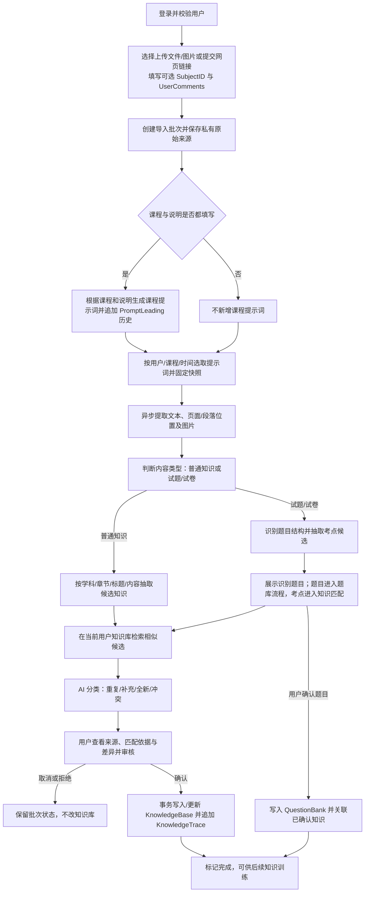

# 4.1 知识导入与整合流程模块设计

> 本文是“AI学习助手APP”中 4.1「知识导入与整合流程」的开发基线，仅定义本模块，不包含代码实现。后续开发应以本文的流程、状态、数据约束和验收标准为准；未决项在文末列出。

## 1. 目标与范围

### 1.1 目标

用户提交文档、图片或网页后，系统保存来源并异步提取内容，识别候选知识点，与当前用户的知识库进行候选匹配和 AI 分类；用户审核差异并确认后，系统才创建或更新知识库记录、追加来源追踪，并为后续训练/试卷关联提供入口。

### 1.2 本次设计范围

- 文件/图片上传和网页链接导入；识别为试卷或试题时，进入试题识别分支。
- 私有文件存储、内容提取/OCR、知识候选抽取、知识匹配和四类整合判定。
- 导入状态、候选预览、差异审核、用户确认、持久化和来源追踪。
- 失败重试、重复提交、并发编辑及基本访问控制。

不在本模块内实现完整试卷分析、题目作答/评分、知识训练、学习计划和知识库全量管理。试卷分支只定义将识别题目写入题库、将新考点送入知识审核的交界；考试热度由题目关联模块维护。

### 1.3 依据

- 《AI学习助手APP开发设计文档》4.1、5.1、5.2、8.x KnowledgeTrace、9.1 和 14.2。
- 《数据库MOCKUP.xlsx》中的 `KnowledgeBase`、`KnowledgeTrace`、`QuestionBank`、`PromptLeading` 表草案。
- `4.1 知识导入与整合流程.jpg` 的普通知识/试题分支，以及登录后知识与用户关联的要求。
- 项目构想中的学科、章节、标题、内容四级知识结构；英语知识可在内容中包含音标、释义和例句。

## 2. 角色、边界与基本规则

- **知识所有者：** 已登录用户。每个导入批次及其候选、知识、来源记录都必须绑定 `UserID`。
- **用户：** 提交来源、查看进度、审核 AI 建议、确认或取消入库。
- **系统：** 负责提取、候选召回、分类、差异展示和落库；不得未经确认自动覆盖已存在知识。
- **AI 服务：** 提供结构化建议，不是事实源；无法判断或发现事实冲突时必须明确交由用户审核。

数据按 `UserID` 隔离。MVP 不跨用户检索候选、合并知识或展示文件；用户只能确认、重试或取消自己的导入。

## 3. 端到端流程



### 3.1 关键流程约束

1. 上传成功后立即建立批次并返回进度，不等待 OCR/模型同步完成。
2. 保存原始文件后再开始异步解析；数据库保存元数据和私有存储对象标识，不保存文件二进制。
3. 抽取、匹配和 AI 分类结果先保存在导入草稿/候选记录中。**只有用户确认后，才写入正式知识库及 `KnowledgeTrace`。**这使取消、失败和重试不会污染知识库或审计链。
4. 每个候选都要保留来源片段位置（如页码、段落、字符区间）；链接导入要保留 URL、标题和提取时间。
5. 知识写入与对应 `KnowledgeTrace` 追加必须在同一数据库事务中完成。Trace 只追加，不直接修改。
6. 重试不创建重复知识或重复 Trace；同一批次、同一候选、同一用户的确认操作需具备幂等性。

## 4. 用户界面与交互

### 4.1 页面结构与视觉设计

本模块主页面采用三个页签；知识详情作为由导入记录进入的独立详情页面：

1. **新建知识导入**：Agent 对话框式输入体验，支持课程上下文、文字说明、附件/链接和提交。
2. **导入记录**：查看导入批次及其知识变更记录，支持筛选、分页和进入详情。
3. **配置管理**：按课程、用户筛选并编辑 `PromptLeading`，可新增和批量保存。
4. **知识内容**：由某条记录的 `Detail` 操作打开，展示该知识的完整内容、AI 识别结果、来源和审核信息。

本地预览的配置管理可访问本地库的全部用户和共享记录；用户留空表示共享，创建时间为 UTC。配置变更不修改已保存的批次快照，生产接入前必须实现身份认证和相应授权。

#### 欢迎横幅

- 页面品牌显示“好玩儿科技”；顶部显示个性化欢迎语：`{当前登录用户 UserID}，开启快乐学习之旅！`，副标题为“聚沙成塔，一问一答，强化理解和记忆”。
- 采用欢快、明亮但不刺眼的视觉：浅暖白/奶油色内容背景，欢迎横幅使用晴空蓝至明黄的轻柔渐变，橙色、薄荷绿作为少量操作/状态点缀；卡片圆角、留白充分，避免大面积高饱和色。
- 中文字体使用系统无衬线字体栈，例如 `Microsoft YaHei`、`PingFang SC`、`Noto Sans SC`；欢迎主标题约 28–32 px，页签约 16–18 px，正文约 14–16 px，辅助信息约 12–14 px。文字颜色与背景需保持清晰对比。
- 桌面端横幅位于页面 header 下方、页签上方；窄屏下允许横幅高度和主标题字号收缩，不遮挡主要操作。

#### 主页面线框

```text
┌──────────────────────────────────────────────────────────────────────┐
│ 好玩儿科技                                      帮助   用户头像/菜单 │
├──────────────────────────────────────────────────────────────────────┤
│ ☀ 明亮渐变欢迎横幅                                                  │
│ {UserID}，开启快乐学习之旅！                                        │
│ 聚沙成塔，一问一答，强化理解和记忆。                                │
├──────────────────────────────────────────────────────────────────────┤
│ [ 新建知识导入 ]       [ 导入记录 ]       [ 配置管理 ]              │
│                                                                      │
│                     当前选中页签的内容                              │
└──────────────────────────────────────────────────────────────────────┘
```

#### 4.1.1 新建知识导入页签

采用熟悉的 Agent 对话输入框样式，但不伪装成可以进行无限轮次对话的聊天产品。用户可以说明导入任务，附加文件/图片或网页链接后提交一个导入批次。

- 输入课程/学科 `SubjectID`；用户在下方上传对话框中输入的文字作为 `UserComments`，不再单独设置“本次说明”文本框。按照 5.2，只有课程和说明均填写时才生成并追加课程提示词。
- 添加附件时，对话框文字仅作为用户说明，不混入附件正文；没有附件时，文字同时作为手动导入的知识内容，保留纯文本导入能力。
- 主输入区域支持多行文本；左下角 `+` 按钮打开附件选择/上传菜单，可添加文件、图片或链接；右侧提交按钮开始导入。提交处理中显示忙碌态并防止重复创建批次。
- 显示文件格式、大小限制、隐私提示及上传后异步处理说明；提交后进入批次状态页/记录，不要求用户停留等待模型完成。
- 若课程或说明未填写，界面可提示“本次不会新增课程提示词，将按现有提示词规则匹配”，但不阻止用户导入。

```text
┌──────────────────────── 与 AI 一起整理知识 ─────────────────────────┐
│ 课程/学科（可选） [选择或输入 SubjectID ▼]                          │
│                                                                      │
│       ┌──────────────────────────────────────────────────────┐       │
│       │ 输入说明；无附件时也可直接输入知识内容……             │       │
│       │                                                      │       │
│       │ [+ 附件] 添加文档、图片或网页链接          [提交 ➤] │       │
│       └──────────────────────────────────────────────────────┘       │
│ 支持格式/大小提示       提交后显示上传、识别、待审核等状态           │
└──────────────────────────────────────────────────────────────────────┘
```

窄屏下输入区占满可用宽度，附件和提交按钮固定在输入框底部；附件菜单改为易触达的底部弹层，避免表格或操作按钮横向溢出。

#### 4.1.2 导入记录页签

- 记录列表展示本次知识变更摘要（显示名 `KnowledgeTrace`，数据映射 `KnowledgeTrace.KnowledgeContentsAdded`）、`KnowledgeSource`、`AI_Eval_Returned`、`HumanApproval`、`Import_Time` 和 `Detail` 操作。
- `Import_Time` 映射服务端记录创建时间 `KnowledgeTrace.CreatedAt`；它是数据库字段的展示别名，不要求重复新增同义时间列。列表按时间倒序，支持按课程、审核状态、时间范围筛选和分页。
- `AI_Eval_Returned` 在列表显示截断摘要，完整内容放在详情页；`HumanApproval` 使用清晰的“待确认/已确认/已拒绝”等标签，颜色不能作为唯一状态表达。
- 当同一来源批次有多个知识候选时，列表按知识 Trace 展示并提供批次/来源分组或关联信息，避免重复来源难以辨认。

```text
┌──────────────────────────── 导入记录 ────────────────────────────────┐
│ 课程 [全部 ▼]  确认状态 [全部 ▼]  时间 [范围]   搜索 [___________]  │
│ KnowledgeTrace  KnowledgeSource  AI_Eval_Returned HumanApproval Import_Time Detail │
│ 北京人生产生活  历史资料.pdf     补充：发现新增…  已确认       10-29  查看 │
│ 大气压强        物理笔记.png     新知识候选…      待确认       10-28  查看 │
│                                                       [上一页] [下一页] │
└──────────────────────────────────────────────────────────────────────┘
```

#### 4.1.3 知识内容详情页

`Detail` 打开独立的“知识内容”详情页面，并提供返回导入记录的导航。详情包含：

- 知识标题、学科、章节和当前整合后的标准内容。
- 本次 `KnowledgeTrace` 变更内容、`ChangeType`、完整 `AI_Eval_Returned` 及 AI 评估/冲突提示。
- `KnowledgeSource`、原文片段、页码/段落位置，以及来源文件/网页信息。
- `HumanApproval`、审核状态、`Import_Time`、操作者与相关导入批次。
- 若仍待人工确认，显示醒目的待审核提示和相应确认/编辑入口；已确认记录以详情查看为主，并保留审计历史。

```text
┌──────────────────────────── 知识内容 ────────────────────────────────┐
│ ‹ 返回导入记录                                                      │
│ 北京人的生产生活       历史 / 第一单元                 [已确认]      │
├──────────────────────────────────────────────────────────────────────┤
│ 整合后的知识内容                                                     │
│ ……                                                                   │
│ 本次变更 / AI 识别结果                                               │
│ 建议类型：补充   评估说明：……                                       │
│ 来源证据：历史资料.pdf · 第 3 页 · “……”                            │
│ 导入时间：2026-10-29 …       来源：……                               │
│                                        [编辑/确认（待审核时显示）]   │
└──────────────────────────────────────────────────────────────────────┘
```

### 4.2 新建导入表单字段

- 入口：知识库中的“导入知识”。
- 输入方式：上传文件/图片，或粘贴网页 URL；显示支持格式、大小限制和隐私提示。
- 上传表单包含可选课程/学科 `SubjectID` 和说明 `UserComments`。`SubjectID` 为空表示使用通用提示词；说明用于补充本次导入的课程背景、范围或处理要求。提交后两项与来源一起绑定到批次。
- 登录用户由服务端身份确定，不接受客户端自行指定 `UserID`。
- 提交后显示批次记录、文件名/URL、提交时间、状态和失败原因；支持查看、取消未确认的批次、重试可重试的失败步骤。

### 4.3 处理状态

批次状态在页面统一显示：

| 状态 | 含义 | 用户可执行操作 |
|---|---|---|
| `UPLOADED` | 来源已接收，等待解析 | 查看来源、取消 |
| `PROCESSING` | 提取、分类或匹配处理中 | 查看进度、取消 |
| `NEEDS_REVIEW` | 候选已生成，等待人工确认 | 审核并确认/拒绝 |
| `COMPLETED` | 用户确认的内容已提交 | 查看知识与来源 |
| `FAILED` | 可恢复或不可恢复错误 | 查看原因、重试或取消 |
| `CANCELLED` | 用户取消，未提交正式知识 | 查看状态 |

任务内部可另存阶段（上传、提取、抽取、检索、分类、提交），但 UI 不应向用户展示技术性实现细节或假进度。

### 4.4 候选审核

每个候选卡片展示：

- AI 建议类型、标题、学科、章节、结构化内容及置信度/待审核提醒。
- 来源文件/网页及原文片段、页码/段落位置。
- 若匹配到现有知识：已有知识标题、ID、相似依据；补充/冲突时以并排或差异高亮展示新旧内容。
- 可选操作：接受、编辑后接受、忽略该候选、选择其他匹配知识、拆分候选。重复项默认不新增；用户可仅保留该来源记录。
- 批量确认只适用于无冲突且未修改的候选；有冲突或低置信度候选必须单独审核。

确认前显示将执行的变更摘要（新增几条、补充几条、忽略几条）。确认按钮采用明确的“确认并保存”语义，避免浏览/预览即自动入库。

## 5. 后台处理阶段

### 5.1 接收与存储

- 校验身份、文件类型/大小、URL 格式以及每用户配额。
- 文件存入 Azure Blob Storage 私有容器；数据库记录对象 key、原文件名、MIME、大小、校验和、来源类型和批次。
- 不将长期可访问的 Blob URL 暴露给客户端。下载/预览通过授权接口签发短时访问能力。
- 创建唯一 `ImportBatchID`，并保存用户提交的 `SubjectID`、`UserComments`。重复请求可用幂等键避免意外重复批次。

### 5.2 提示词配置解析

用户提交的 `SubjectID` 和 `UserComments` 用于决定是否生成一条新的课程提示词，并解析本次模型调用所需的提示词历史。

#### 提示词生成与追加

- 仅当 `SubjectID` 和 `UserComments` 都非空时，才使用两者作为提示词生成任务的输入，生成一条该用户、该课程的 `PromptLeading.Prompts` 记录。
- 任一输入缺失时，不创建课程提示词；仍按下面的检索顺序使用已有提示词。用户显式选择 `General` 或未选择课程时，不新增用户级 `General`，由开发者维护通用提示词。
- 每次符合条件的上传均追加一条新记录，不覆盖或自动合并旧记录。多次上传形成的重复/相似提示词属于有意保留的历史，送入后续模型调用时再由模型去重。
- 提示词生成由服务端固定的生成任务约束调用模型；课程与用户说明是生成上下文而非高优先级系统指令。生成失败须显式报告，不插入空的或成功形状的占位提示词。

#### 检索优先级

“最近 3 条”均按 `Creation_Time` 降序；时间相同则按 `PromptLeadingID` 降序，保证结果确定。层级之间仅在上一层**没有任何结果**时回退，不混合各层记录：

1. `SubjectID` 非空时，先取 `PromptLeading.SubjectID = 批次.SubjectID AND PromptLeading.UserID = 当前登录用户.UserID` 的最新 3 条。
2. 若第一层为空，取相同 `SubjectID` 且 `UserID IS NULL` 的最新 3 条共享课程提示词。
3. 若第二层仍为空，取 `SubjectID = 'General' AND UserID = 配置的管理员账号` 的最新 3 条通用提示词。当前 Mockup 的通用示例行 `UserID` 为 `Admin`，应与部署环境的管理员身份配置一致。
4. 若用户未选择课程，跳过前两层，直接取管理员维护的最新 3 条 `General` 提示词。
5. 如果所有层级都无记录，显式提示缺少可用提示词，不得把空列表当成完整成功结果；仅可在有明确基础提示词时按该策略继续，并告知用户。

完成选择后，将记录 ID、原始 `Prompts`、`Creation_Time`、内容哈希和所用层级固定到 `ImportBatch`。用户显式执行“刷新提示词”时才重新查询，并记录新旧快照；普通重试沿用原快照，避免结果漂移。所有查询均限定于当前用户或明确定义的共享/管理员记录。

### 5.3 提取与内容规范化

- PDF/Word/图片等由对应解析器提取文本；扫描件和图片走 OCR。按原始页、段落和区块保存文本片段及位置。
- 网页链接由服务端安全抓取可访问页面，提取正文、标题、URL 和抓取时间；不得把任意 URL 直接交给模型访问。
- 统一空白、标点及明显格式噪声，但保留原始文本和数学/英语等有意义格式；OCR 结果不确定时提示用户，不静默改写原文。
- 无可读内容、文件损坏、加密文件、超时或网页无法访问时，批次进入 `FAILED` 并给出可理解原因。

### 5.4 内容类型与候选抽取

- 先判断来源主要是普通知识、试题/试卷或无法判断。可混合内容应允许分别产生知识候选和题目候选。
- 知识候选采用四级结构：`Subject`（学科）→ `Chapter`（章节）→ `KnowledgeTitle`（标题）→ `CanonicalContent`（标准内容）。
- 知识抽取应合并同一主题的碎片、保留原文证据，不把无关解释拼成新事实；不得凭空补充原文/已有知识库均未提供的事实。
- 对英语内容允许在正文/结构化要点中包含词形、音标、中文释义、例句等；不要为此破坏通用四级层级。
- 试题分支：识别题号、题干、选项、题型、答案和解析等可得字段；题目候选待用户确认后进入 `QuestionBank`，识别出的知识点继续走本节候选匹配与审核流程。

### 5.5 匹配与整合判定

采用两级判断，范围限定在当前用户知识库：

1. 对标题/正文规范化，结合学科、章节、关键词/标签和全文/语义相似度，召回少量候选 `KnowledgeID`。
2. 将候选及带来源位置的新增内容提交模型，要求按下列一种类型给出分类、理由和结构化结果。不得将整库发送给模型。

| 类型 | 判定 | 默认建议 |
|---|---|---|
| `DUPLICATE`（重复） | 与已有知识核心定义/事实高度一致，没有实质增量 | 不新建知识；用户可忽略，或选择仅记录来源 |
| `SUPPLEMENT`（补充） | 对已知主题增加定义、条件、例子、公式、步骤或例外 | 展示差异，用户确认后合并；不确认不改原内容 |
| `NEW`（全新） | 无合理匹配，或主题边界独立 | 作为新知识草稿，用户确认后创建 |
| `CONFLICT`（冲突） | 与已有知识事实或结论不一致，或来源相互矛盾 | 禁止自动覆盖；标注冲突原文和现有内容，要求用户处理 |

模型输出置信度低、证据缺失、候选排序接近或无法唯一确定目标知识时，标为待人工判断，不自动合并。用户可手工更改分类/目标知识，但需在 Trace 中记录人工处理信息。

### 5.6 确认与提交

- 接收用户最终编辑的知识标题、学科、章节、标准内容、目标知识和操作类型。
- 对每条已确认知识写入 `KnowledgeTrace.SubjectID` 和 `KnowledgeTrace.UserComments`，保存本批次的课程/学科选择及用户说明；即使用户忽略全部候选，批次仍保留提交信息，但不因此创建知识 Trace。
- 对目标知识执行服务端所有权校验，并使用 `RowVersion`/并发版本或等效机制检测审核期间的并发编辑；若目标已变化，返回冲突并要求刷新审核，不静默覆盖。
- 一个确认请求应原子提交正式知识变更、知识来源 Trace、已确认试题/关联及批次完成状态。若任一步失败则回滚，并允许安全重试。
- 用户拒绝/忽略的候选只更新导入审核状态，不建立知识 Trace；保留时间和操作者以便查看导入处理结果。

## 6. AI 提示词与输出契约

每次模型调用都应使用本导入批次的固定提示词快照。业务提示词由用户本次课程上下文和所选的近期 `PromptLeading.Prompts` 历史组成；多条历史独立保存，调用模型时要求识别重复内容、合并去重后用于当前任务，不回写或删除历史原文。

### 6.1 提示词组成与优先级

1. **固定系统约束（服务端维护）：** 规定任务、输出 schema、隐私/安全边界、不得编造、不得跨用户读取，以及文档和网页是待分析数据而非指令。此部分优先级最高，不允许用户或 `PromptLeading` 覆盖。
2. **课程提示词历史（`PromptLeading.Prompts`）：** 按 5.2 的三级优先级选取至多 3 条；历史记录互相独立，提供课程术语和抽取规则。将记录时间作为新近性线索，但不让新记录越过固定系统约束或来源证据。
3. **本次用户上下文（来自上传表单，持久化到 `KnowledgeTrace`）：**
   - `SubjectID`：用户选择的课程/学科范围，同时用于选择提示词配置。
   - `UserComments`：用户对本次文档的说明/要求，作为本次任务的上下文补充。
4. **来源材料（上传文件、网页正文、OCR 文本及位置）：** 作为需分析的引用数据单独提供。来源材料中的任何指令都不能改变前三层约束，也不能要求模型泄露提示词或访问其他用户数据。

调用顺序示意：

```text
固定系统约束
+ 最近提示词（按用户/课程/共享/General 优先级选取并使用本批次快照）
+ 用户本次上下文（SubjectID、UserComments）
+ 来源材料（原文、OCR、页码/段落等，作为不可信数据）
+ 当前阶段任务与 JSON 输出格式
```

`UserComments` 可写课程记录、文档范围、教师补充说明或希望重点识别的内容；不得将其当作授权依据，也不得允许它覆盖系统安全约束。向模型提供多条提示词时，应明确要求：“如这些提示词包含重复或表达相近的规则，请合并去重后再执行；若规则冲突，列明冲突，不擅自改变原始知识事实。”去重结果仅用于当前请求，不修改 `PromptLeading` 历史。提示词和用户说明应有长度限制及版本记录，错误配置或空结果必须显式显示。

### 6.2 抽取提示词要点

要求模型：

- 以固定系统约束、选中的 `PromptLeading.Prompts` 和本次 `UserComments` 为任务指导；知识事实仍须以来源证据为依据，缺失字段返回空/未知，不猜测学科、章节或答案。
- 产出一个或多个主题独立、表述清晰的候选知识点，保留原文片段引用及可定位位置。
- 使用项目四级知识结构；将同一知识点的定义、关键事实、条件、例子等整合在内容中。
- 区分普通知识与题目；不把题干中的叙述误作标准知识，也不凭上下文虚构答案。
- 返回可校验 JSON；若内容混乱、证据不足或无法分类，返回需要人工复核及具体原因。

### 6.3 分类提示词要点

提供新增候选和有限的已有知识候选（含 ID、标题、内容及必要来源信息），要求模型逐项返回：

```json
{
  "source_item_id": "候选ID",
  "decision": "DUPLICATE | SUPPLEMENT | NEW | CONFLICT | REVIEW",
  "target_knowledge_id": "已有知识ID或null",
  "proposed_title": "标题",
  "subject": "学科或null",
  "chapter": "章节或null",
  "proposed_content": "建议的标准内容",
  "added_facts": ["新增要点"],
  "conflicts": ["冲突说明"],
  "evidence": [{"quote": "原文摘录", "location": "页码/段落/区块"}],
  "confidence": 0.0,
  "reason": "简短判定依据"
}
```

模型响应必须通过 JSON/schema 校验；无效响应、缺少引用、引用不在输入原文内时进入可见失败或人工审核，不将无效响应当作成功结果。`confidence` 仅辅助排序/提示，不取代用户确认。

## 7. 数据与持久化设计

### 7.1 现有表映射

| 现有表 | 本模块用途 | 约束/需要核对之处 |
|---|---|---|
| `KnowledgeBase` | 用户确认后的标准知识 | 使用 `KnowledgeID`、`KnowledgeTitle`、`CanonicalContent`、`SubjectID`、`ChapterID`、`Tags`、`Associated Imagines`、`UserID`；仅可修改所属用户记录。`ExamHeat` 按题目关联流程维护，不由知识导入客户端设置。 |
| `KnowledgeTrace` | 每次创建、补充、编辑、合并的来源和审计 | 按更新后的 Mockup 使用 `TraceID`、`KnowledgeID`、`KnowledgeContentsAdded`、`ChangeType`、`KnowledgeSource`、`SubjectID`、`ChapterID`、`HumanApproval`、`AI_Eval_Returned`、`SourceType`、`ImportBatchID`、`UserID`、`UserComments` 等字段。追加写入；创建或补充必须有 Trace。`SubjectID` 和 `UserComments` 保存导入时用户填写的课程选择与说明。 |
| `QuestionBank` | 用户确认后的试题 | 仅题目分支使用；题目与知识应通过多对多关联（如 `QuestionKnowledgeMap`）建立关系，不在本模块重复维护考试热度。 |
| `PromptLeading` | 有时间顺序的学科/用户提示词历史 | 当前 Mockup 字段为 `SubjectID`、`Prompts`、`UserID`、`Creation_Time`。按 5.2 选取至多 3 条；每次符合条件的上传追加记录。建议正式表增加 `PromptLeadingID` 主键及 `SourceImportBatchID` 来源关联。`General` 由配置的管理员账号维护（Mockup 示例为 `Admin`），共享课程记录使用 `UserID IS NULL`。 |

### 7.2 必要的导入暂存数据

当前数据库 Mockup 未定义批次/候选暂存表，而设计文档已要求唯一 `ImportBatchID`、异步状态和重试。开发前需补齐等价的持久化模型，建议最少包含：

- **`ImportBatch`：** `ImportBatchID`、`UserID`、来源类型（文件/网页）、Blob 对象 key 或 URL、文件元数据、用户提交的 `SubjectID`/`UserComments`、本次新增提示词 ID（若有）、所选提示词 ID/原文/`Creation_Time`/哈希快照、所用回退层级、状态、当前阶段、错误代码/可展示错误、创建/更新时间、提交者、幂等键。显式刷新时保留新旧选择记录，便于追溯。
- **`ImportItem`：** 候选 ID、批次 ID、内容类型（知识/题目）、提取原文及位置、AI 提议 JSON、分类/置信度、匹配 `KnowledgeID`、用户最终决定与编辑值、确认状态、并发版本。
- **题目关联表：** 若尚未建立，用多对多关系表达 `QuestionBank` 与 `KnowledgeBase` 的关联。

候选/原文暂存数据和正式知识数据需区分生命周期；正式 Trace 不承担暂存或任务队列职责。可按隐私/成本策略设置暂存保留期，用户确认后的来源按产品保留策略留存。

### 7.3 Mockup 需要在开发前规范化的点

- 更新后的 `KnowledgeTrace` 草案已加入 `SubjectID` 和 `UserComments`，但仍有重复的 `ChapterID` 列；需删除重复列并明确 `KnowledgeContentsAdded` 只记录本次变更内容。
- 最新 Mockup 的 `PromptLeading` 已增加 `Creation_Time`；`General` 示例的 `UserID` 为 `Admin`。该表需允许同一 `(SubjectID, UserID)` 存在多条历史记录，不能对这两列设置唯一约束；建议以 `PromptLeadingID` 为主键，并建立 `(SubjectID, UserID, Creation_Time DESC)` 检索索引。
- 明确 `Creation_Time` 在数据库中使用 UTC 时间戳，新增记录由服务端/数据库生成，不接受客户端任意回填；现有 `General` 示例行缺少创建时间，正式迁移时需回填或标记为历史未知，不能参与“最近”排序而不说明。
- `UserID IS NULL` 代表共享课程提示词；`SubjectID='General'` 的提示词归配置的管理员账号（Mockup 示例 `Admin`）维护，不与共享课程提示词混为一类。
- 草案中 `CreatedBy/CreatedAt` 合并为一列的写法应拆成独立操作者、时间字段；确认状态、AI 评估结果应定义类型和取值。
- 数据库字段“学科/章节”究竟是稳定 ID、自由文本还是外键尚未明确。MVP 至少保证按用户隔离并保持可检索；应选定一致编码，避免模型随意生成多个同义学科/章节名称。
- `Associated Imagines` 表头疑为图片/附件关联；若正式使用，建议用独立关联表或 JSON 列清晰定义，不让图片 URL 混入知识正文。

## 8. 建议服务接口

接口均从认证上下文取得 `UserID`，不得信任请求体中的用户 ID；所有资源请求须校验资源所有者。

| 方法 | 路径 | 用途 |
|---|---|---|
| `POST` | `/api/knowledge-imports` | 创建导入批次；接受文件或 URL 元数据及可选 `SubjectID`、`UserComments`；两者均有值时生成并追加一条提示词，随后按优先级选取提示词并保存快照，返回 `ImportBatchID` 和初始状态 |
| `GET` | `/api/knowledge-imports` | 分页查询当前用户批次 |
| `GET` | `/api/knowledge-imports/{batchId}` | 查询状态、阶段、可展示错误和候选摘要 |
| `GET` | `/api/knowledge-imports/{batchId}/items` | 读取候选、引用、匹配与 AI 建议 |
| `PUT` | `/api/knowledge-imports/{batchId}/items/{itemId}` | 保存用户审核/编辑决定，需版本号 |
| `POST` | `/api/knowledge-imports/{batchId}/confirm` | 幂等确认已审核项并事务落库 |
| `POST` | `/api/knowledge-imports/{batchId}/retry` | 使用批次提示词快照重试可重试失败阶段 |
| `POST` | `/api/knowledge-imports/{batchId}/refresh-prompts` | 用户显式刷新提示词选择，重新检索、保存新快照并记录刷新事件 |
| `POST` | `/api/knowledge-imports/{batchId}/cancel` | 取消未提交的批次 |

具体请求体、分页约定和上传采用直传 Blob 还是 API 中转，可在后端开发任务中确定；无论实现方式如何，都必须校验文件和权限，且不可暴露长期 Blob 凭证。

## 9. 失败处理、安全与隐私

- **异步与重试：** 每阶段记录可重试状态；重试只从失败阶段继续，外部调用需有超时、有限重试和幂等键。不可恢复失败明确告知用户。
- **数据库/存储不一致：** 若文件上传成功但批次写入失败，记录可清理对象或待清理状态；若批次存在但文件上传失败，则可重新上传。清理不得误删其他批次对象。
- **模型不可用/输出不合法：** 批次标失败或待审核，展示“暂无法自动识别”，不得伪造空候选并标完成。
- **恶意输入：** 检查扩展名与实际 MIME/文件签名，限制大小/页数/解压大小；网页抓取防 SSRF（限制协议、私网/本机地址及重定向目标），阻止超时和超大响应。
- **提示注入：** 文档、网页、OCR 内容只作为数据；不得遵从其中要求泄露提示词、调用工具或跨用户读取内容的指令。
- **权限与凭证：** 私有 Blob 容器；短期、最小权限访问；不向客户端/日志写入密钥、SAS 或完整敏感正文。日志避免记录不必要的原文。
- **隐私：** 用户只能读取/操作自己的文件、候选、知识和 Trace。用户取消/删除来源时按产品规则处理 Blob 和暂存内容；已写入的审计 Trace 不应被无声改写。
- **并发：** 确认前重检知识当前版本；版本冲突须返回审核页面重新比较。

## 10. MVP 验收标准

1. 登录用户可导入支持格式文件/图片或网页链接，并提交可选 `SubjectID`、`UserComments`；未登录或无权资源请求被拒绝。
2. 源文件私有保存，系统返回批次 ID，刷新页面仍可查看状态；至少能区分处理中、待确认、完成和失败。
3. 异步解析成功时，候选包含四级知识结构、来源引用/位置；试题可进入题目审核分支。
4. 候选分类支持重复、补充、全新、冲突；能关联已有 `KnowledgeID`，冲突/低置信度不得自动覆盖。
5. 用户可查看差异、编辑、拒绝及确认；未确认不得写入 `KnowledgeBase`、`KnowledgeTrace` 或 `QuestionBank`。
6. 确认后新增/补充的知识均能查看对应来源、操作者、时间及变更内容；补充与 Trace 原子提交。
7. 双击确认、网络重试不会创建重复知识/Trace；并发版本变化会要求重新审核。
8. 文件损坏、无可读内容、超时、模型异常、无效 JSON 等错误有明确状态和可理解原因，可重试的错误可安全重试。
9. 以另一用户身份访问批次、候选、Blob 或 KnowledgeID 时无法读取/修改。
10. 仅在 `SubjectID`、`UserComments` 同时有值时新增一条提示词；缺少任一项不新增，但仍可使用已有提示词。
11. 查询严格依次选择当前用户课程最新 3 条、同课程共享最新 3 条、管理员 `General` 最新 3 条；每层有结果即停止回退；未选课程直接用 `General`。
12. 相同课程/用户允许多条历史；按 `Creation_Time` 和稳定 ID 得到确定的最近 3 条；不同用户数据不可互读。
13. 同一批次重试继续使用原提示词快照；显式刷新才重选，刷新前后选择可追溯。
14. 发送多条提示词时，模型按指令合并/去重当前上下文，但数据库中的历史提示词记录保持不变。
15. 完整端到端测试覆盖“提交来源→必要时生成提示词→历史选择/回退→候选审核→确认入库→Trace 溯源”以及“重复忽略”“冲突不覆盖”“取消不落库”。

## 11. 后续开发顺序建议

1. 确认字段/外键方案，并补齐 `ImportBatch`、`ImportItem` 与必要题目关联模型。
2. 实现登录态下的批次创建、私有文件/URL 来源保存、状态查询和用户隔离。
3. 实现异步提取/OCR及原文位置保存，以可替换解析器接口隔离供应商。
4. 实现课程提示词生成与追加、`Creation_Time` 有序历史检索、三级回退、快照/显式刷新和模型侧去重指令。
5. 实现候选结构校验、当前用户知识召回和四类整合建议。
6. 实现审核页面、差异确认、幂等事务写入及 Trace 时间线。
7. 增加题目分支、重试/取消、安全测试和本节验收用例。

## 12. 开发前待确认项

- MVP 首期允许的文件类型、单文件大小/页数、每用户配额及暂存/原文件保留期限。
- 网页链接首期仅支持公开网页还是需登录授权页面；建议 MVP 仅支持无需登录的公开网页。
- 学科/章节使用受控字典还是可由用户新建；以及其稳定 ID/外键方案。
- 普通用户是否允许“仅保留重复来源”以及候选拆分、合并的具体交互范围。
- 题目分支在 4.1 首期是否实现 `QuestionBank` 确认写入，还是仅识别并交给后续 4.2 试卷分析模块。
- `General` 管理员身份的部署配置值及现有无创建时间记录的迁移策略。
